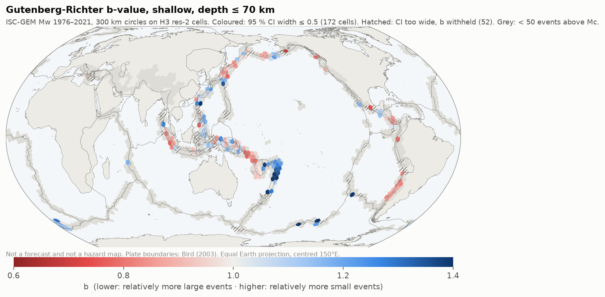
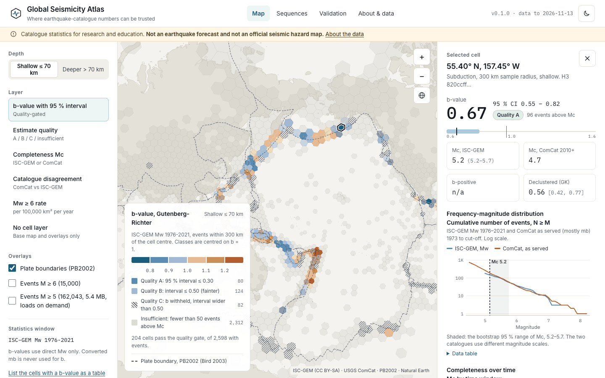

# Global Seismicity Atlas

**Live site: https://ismoilovdevml.github.io/seismicity-atlas/**

An open, reproducible world map of earthquake-catalogue statistics, built only from free global catalogues
(ISC-GEM and USGS ComCat). For each place it gives:

- how much seismicity there is;
- the magnitude of completeness (Mc), and how it has changed over time;
- the Gutenberg-Richter b-value **with its 95 % interval and a quality code**;
- how well the two main open global catalogues (ISC-GEM and USGS ComCat) agree;
- Omori-Utsu decay parameters for the largest aftershock sequences since 1990.

The main message is **where the catalogue numbers can be trusted, and where they cannot.**

> **Not a forecast. Not a hazard map.** These are descriptive statistics of earthquake catalogues, for research
> and education. They do not predict earthquakes and must not be used in place of an official seismic hazard
> assessment.



## Key results (data cut-off 2026-11-13)

| | Value |
|---|---|
| Events analysed | ISC-GEM 74,153 (1904–2021); ComCat M ≥ 4.5: 294,223 (1973–2026-11-12) |
| Duplicates | 58,666 of 58,982 ISC-GEM events in 1973–2021 matched in ComCat (99.5 %); median offset 1.1 s, 9.6 km |
| Global b, ISC-GEM Mw 1976–2021 | shallow ≤ 70 km: **1.043 [1.025, 1.059]**; deeper: **0.969 [0.945, 0.996]** |
| Cells with a trusted b (95 % interval ≤ 0.5) | 204 shallow and 70 deeper, out of 2,598 cells that hold events |
| Global completeness (ISC-GEM, shallow) | Mw 5.7 for 1976–2003, 5.2 for 2004–2021 |
| USGS M4.5+ feed, as served | complete above about 4.7 (mostly mb) worldwide since 1993 |
| Omori fits | 40 sequences since 1990: 17 quality A, 10 B, 8 C, 5 insufficient |

### Validation (ours vs published)

| Test | Ours | Published | Verdict |
|---|---|---|---|
| Global b, deep, 1964–2009 | 0.997 [0.962, 1.033] | 0.99 (Michael 2014) | match |
| Global b, shallow, 1918–2009 | 1.078 [1.056, 1.102] | 1.05 (Michael 2014) | close; just outside our interval |
| Mc, deep, 1964–2009 | 5.7 | 5.7 (Michael 2014) | match |
| Mc, shallow, modern periods | 5.2–5.7 | 5.7–6.0 (Michael 2014, catalogue v1) | ours 0.1–0.5 lower (newer catalogue release) |
| b, subduction boundaries | 0.999 [0.977, 1.020] | 0.98 (β 0.654, Kagan & Jackson) | match |
| b, oceanic spreading ridges | 1.447 [1.386, 1.509] | 1.2–1.65 (β 0.8–1.1, Kagan 2002) | match |
| b, young vs old subducting slabs | 0.943 vs 1.089 (intervals do not overlap) | b increases with slab age (Nishikawa & Ide 2014) | match |
| b, California | 0.919 [0.757, 1.111] | ≈ 1.0 (Hutton et al. 2010) | match (wide) |
| b, Chile | 0.914 [0.844, 0.984] | ≈ 1 (weak source) | **mismatch** |
| b, Italy | 35 events above Mc | ≈ 1.0 | not testable |
| Synthetic cells, 100–1000 events | median bias ≤ 0.021, CI coverage 0.88–0.98 | true b | match |
| Omori p, synthetic | 1.063 ± 0.025 | 1.05 | match |

Full tables and the reasons for each verdict: [docs/validation.md](docs/validation.md).

## Documentation

- [docs/method.md](docs/method.md): method choices with their reasons, and limitations
- [docs/validation.md](docs/validation.md): synthetic, global, regional and plate-boundary tests
- [docs/data.md](docs/data.md): sources, magnitude types, depth, duplicates, coverage
- [docs/data-schema.md](docs/data-schema.md): the data contract for the website (`site/data/`)
- [docs/prior-work.md](docs/prior-work.md): existing tools and literature, and the gap this atlas fills
- [docs/ai-in-seismology.md](docs/ai-in-seismology.md): ML catalogues and LLM agents, and what they can and
  cannot add here

## How to run

```bash
python3 -m venv .venv && .venv/bin/pip install -r requirements.txt
./scripts/run_all.sh        # downloads about 75 MB once (cached in data/raw/), then about 1 minute
```

`run_all.sh` fetches the data, prepares and matches the catalogues, and builds the cells (300 km, plus 200 and
400 km sensitivity runs). It then runs the validation and the Omori fits, writes `site/data/`, draws
`docs/img/`, and runs the tests (`tests/`, 11 tests).

- Downloads are treated as untrusted data: parsed as CSV/JSON only, and Python always runs with `-I`.
- ComCat changes over time. Use `scripts/fetch.py all --refresh --end <date>` to rebuild against newer data.

## Outputs for the website

`site/data/` totals about 11 MB. The files loaded at start-up total about 2.9 MB: `manifest.json`,
`cells.geojson`, `events_m6.json`, `plates.geojson`, `land.geojson` and `coastline.geojson`. Everything else
loads lazily, including 1,292 per-cell detail files. The site needs no third-party basemap tiles. See
[docs/data-schema.md](docs/data-schema.md).

## Website

`site/` is a static site (no build step) that can be served by GitHub Pages as is. Preview it locally:

```bash
cd site && python3 -m http.server 8000   # then open http://localhost:8000/
```

- **Map:** b-value with its 95 % interval and quality code, estimate quality, completeness Mc (ISC-GEM and ComCat),
  catalogue disagreement, M6+ rate; shallow or deeper; plate boundaries; earthquakes M ≥ 6 (M ≥ 5 on request) with
  a time filter and links to USGS event pages; optional globe view. Hover a cell for its values; click it for the
  cell panel (frequency-magnitude distribution, Mc over time, b against cutoff, yearly counts, catalogue
  agreement), with a per-cell CSV download and a side-by-side comparison of two cells' b intervals. Regional
  higher-resolution catalogues appear as an extra layer when `site/data/regional/index.json` is present. The state,
  including the language (English, Uzbek, Russian, Spanish), is kept in the URL hash, so any view can be shared.
- **Sequences:** Omori-Utsu decay charts and quality badges for the 40 sequences.
- **Validation:** every test against published values, including the mismatch and the untestable rows.
- **About & data:** sources, licences, data cut-off, how to cite, downloads.
- Vendored: MapLibre GL JS 5.24.0 (BSD-3-Clause), Inter and IBM Plex Mono (SIL OFL 1.1). No CDN, no third-party
  tiles. Design notes: [docs/ux-notes.md](docs/ux-notes.md); open issues: [docs/known-issues.md](docs/known-issues.md).
- Browser tests: `tests/e2e/` (Playwright for Python; serves `site/` locally). Run
  `pip install playwright pytest && python -m playwright install chromium && python -m pytest tests/e2e`;
  set `E2E_BROWSERS=chromium,firefox,webkit` for all three engines. CI: `.github/workflows/test-site.yml`.



## How to cite

Use the metadata in [CITATION.cff](CITATION.cff) (GitHub shows a "Cite this repository" button), and cite the
underlying catalogues listed below. Please quote the data cut-off date shown on the site.

## Contributing

Issues and pull requests are welcome, especially published regional b-value or Mc estimates that can be added to
the validation table (with the paper, the magnitude type and the completeness used).

## Licences

- **Code:** MIT (see `LICENSE`).
- **Data and figures** (`site/data/`, `docs/img/`, `results/`): **CC BY-SA 4.0**. They are derived from the
  ISC-GEM catalogue, which is CC BY-SA 3.0, and ShareAlike carries over.
- **Attribution required:**
  - ISC-GEM: International Seismological Centre (2026), ISC-GEM Earthquake Catalogue,
    doi:10.31905/D808B825; Storchak et al. 2013; Di Giacomo et al. 2018.
  - U.S. Geological Survey ComCat (U.S. public domain).
  - Plate boundaries: Bird (2003), G3 4(3), 1027, via github.com/fraxen/tectonicplates (ODC-BY 1.0).
  - Natural Earth (public domain).
- **Not redistributed:** the GEM Global Seismic Hazard Map (CC BY-NC-SA). The site may link to it only.
