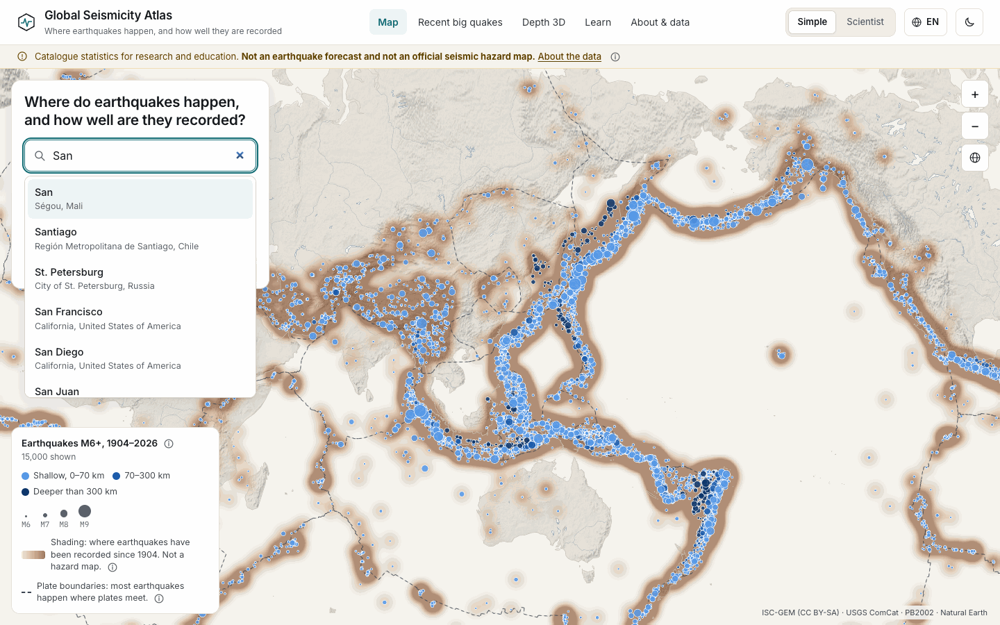
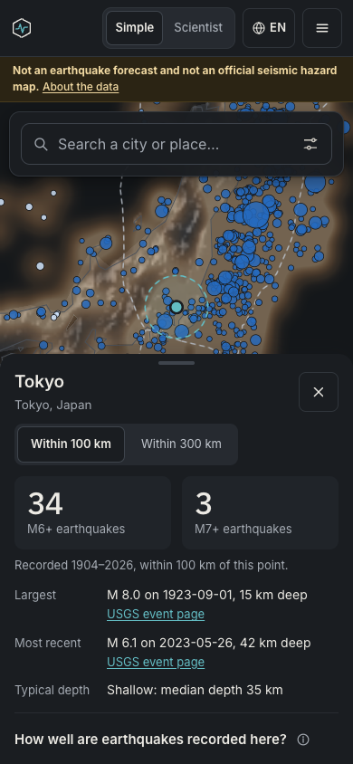
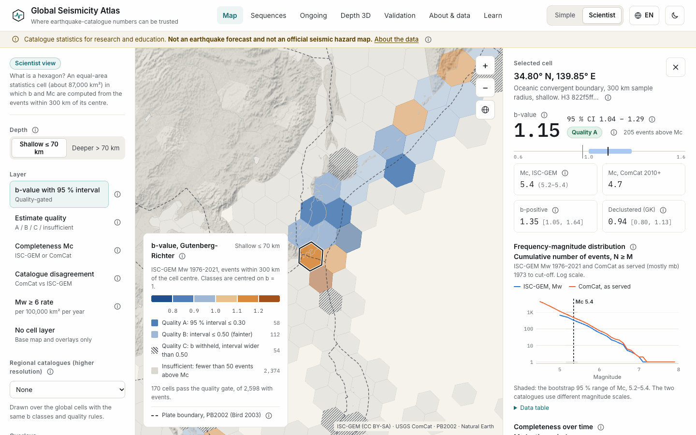
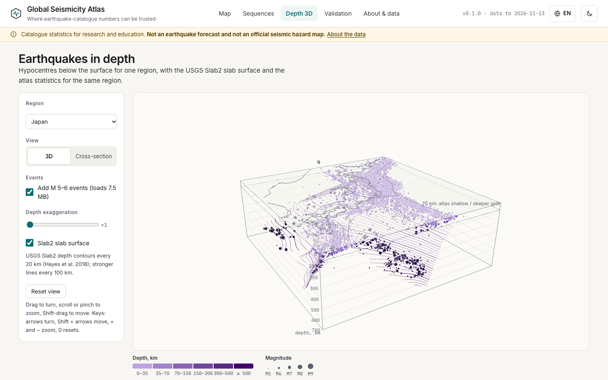

# Global Seismicity Atlas

**Live site: https://ismoilovdevml.github.io/seismicity-atlas/**

An open, reproducible world map of earthquake-catalogue statistics, built only from free global catalogues
(ISC-GEM and USGS ComCat). For each place it gives:

- how much seismicity there is;
- the magnitude of completeness (Mc), and how it has changed over time;
- the Gutenberg-Richter b-value **with its 95 % interval and a quality code**;
- how well the two main open global catalogues (ISC-GEM and USGS ComCat) agree;
- Omori-Utsu decay parameters for the largest aftershock sequences since 1990.

The main message is **where the catalogue numbers can be trusted, and where they cannot.**

The website opens in a **Simple view** for everyone: the recorded earthquakes on a map, a place search, and a card
that says in plain words what was recorded around a place and how well. The **Scientist view** (one switch in the
header) holds the cell statistics behind it. See [Website](#website).

> **Not a forecast. Not a hazard map.** These are descriptive statistics of earthquake catalogues, for research
> and education. They do not predict earthquakes and must not be used in place of an official seismic hazard
> assessment.


## Key results (data cut-off 2026-11-13)

| | Value |
|---|---|
| Events analysed | ISC-GEM 74,153 (1904–2021); ComCat M ≥ 4.5: 294,223 (1973–2026-11-12) |
| Duplicates | 58,666 of 58,982 ISC-GEM events in 1973–2021 matched in ComCat (99.5 %); median offset 1.1 s, 9.6 km |
| Global b, ISC-GEM direct Mw 1976–2021 | shallow ≤ 70 km: **1.035 [1.018, 1.052]**; deeper: **0.936 [0.911, 0.961]** |
| Cells with a trusted b (95 % interval ≤ 0.5) | 170 shallow and 73 deeper, out of 2,598 cells that hold events |
| Global completeness (ISC-GEM direct Mw, shallow) | Mw 5.8 for 1976–2003, 5.3 for 2004–2021 |
| USGS M4.5+ feed, as served | complete above about 4.7 (mostly mb) worldwide since 1993 |
| Omori fits | 40 sequences since 1990: 17 quality A, 10 B, 8 C, 5 insufficient |

### Validation (ours vs published)

| Test | Ours | Published | Verdict |
|---|---|---|---|
| Global b, deep, 1964–2009 | 0.997 [0.962, 1.033] | 0.99 (Michael 2014) | match |
| Global b, shallow, 1918–2009 | 1.078 [1.056, 1.102] | 1.05 (Michael 2014) | close; just outside our interval |
| Mc, deep, 1964–2009 | 5.7 | 5.7 (Michael 2014) | match |
| Mc, shallow, modern periods | 5.2–5.7 | 5.7–6.0 (Michael 2014, catalogue v1) | ours 0.1–0.5 lower (newer catalogue release) |
| b, subduction boundaries | 0.971 [0.948, 0.994] | 0.98 (β 0.654, Kagan & Jackson) | match |
| b, global 1982–2008, m ≥ 5.6 (TGR) | 1.035 [1.012, 1.062] | 1.016 (Kagan 2010, GCMT) | match (mismatch in v0.1) |
| b, oceanic spreading ridges | 1.480 [1.413, 1.565] | 1.2–1.65 (β 0.8–1.1, Kagan 2002) | match |
| b, young vs old subducting slabs | 0.899 vs 1.067 (intervals do not overlap) | b increases with slab age (Nishikawa & Ide 2014) | match |
| b, California | 0.921 [0.741, 1.128] | ≈ 1.0 (Hutton et al. 2010) | match (wide) |
| b, Chile | 0.852 [0.780, 0.931] | 0.855 ± 0.06 (Andean S. America, GCMT; Kagan & Jackson 2013) | match at their settings (0.871 [0.761, 1.015]); the earlier "≈ 1" reference was weak |
| b, Italy | 29 events above Mc | ≈ 1.0 | not testable |
| Synthetic cells, 100–1000 events | median bias ≤ 0.021, CI coverage 0.88–0.98 | true b | match |
| Omori p, synthetic | 1.063 ± 0.025 | 1.05 | match |

Full tables and the reasons for each verdict: [docs/validation.md](docs/validation.md).

### What changed in v0.2

- **b now uses direct Mw only.** ISC-GEM mixes direct moment magnitudes (GCMT) with proxy Mw converted from Ms and
  mb. In 1976–2021 the proxies are 16 % of events at Mw 5.6–6.0 and under 1 % from Mw 7, and alone they give
  b ≈ 1.74, so they raised every b. The ComCat copy has no direct/proxy flag; the magnitude uncertainty 0.10 marks
  direct Mw (99.97 % of events with a GCMT magnitude in ComCat carry it). v0.2 leaves the other 7,049 events
  (12.5 %) out of every b. Details: [method §2.1](docs/method.md), before/after: [validation §10](docs/validation.md).
- Global b: shallow 1.043 → 1.035, deeper 0.969 → 0.936. Trusted cells: 204 → 170 shallow, 70 → 73 deeper.
  Median per-cell change −0.019 (shallow) and −0.036 (deeper).
- Kagan (2010) global and trench b and the Kagan & Jackson (2013) all-subduction b now match (they mismatched).
- Open point: b-positive did not move with b, so part of the per-cell drop may be incompleteness of the direct
  sample just above the floor.
- `ATLAS_B_MAGERR_MAX=all ./scripts/run_all.sh` rebuilds the v0.1 behaviour for comparison.
  `manifest.json` → `method` gains `b_sample` and `b_magerr_max`.

## Documentation

- [docs/method.md](docs/method.md): method choices with their reasons, and limitations
- [docs/validation.md](docs/validation.md): synthetic, global, regional and plate-boundary tests
- [docs/data.md](docs/data.md): sources, magnitude types, depth, duplicates, coverage
- [docs/data-schema.md](docs/data-schema.md): the data contract for the website (`site/data/`)
- [docs/monitor.md](docs/monitor.md): the Sequence Monitor (ongoing sequences), its validation and limits
- [docs/learn.md](docs/learn.md): the Learn pages (18 concepts, four languages), how to add a concept, and where each
  (i) button points
- [docs/prior-work.md](docs/prior-work.md): existing tools and literature, and the gap this atlas fills
- [docs/ai-in-seismology.md](docs/ai-in-seismology.md): ML catalogues and LLM agents, and what they can and
  cannot add here

## How to run

```bash
python3 -m venv .venv && .venv/bin/pip install -r requirements.txt
./scripts/run_all.sh        # downloads about 75 MB once (cached in data/raw/), then about 1 minute
```

`run_all.sh` fetches the data, prepares and matches the catalogues, and builds the cells (300 km, plus 200 and
400 km sensitivity runs). It then runs the validation and the Omori fits, writes `site/data/`, draws
`docs/img/`, and runs the tests (`tests/`, 11 tests).

- Downloads are treated as untrusted data: parsed as CSV/JSON only, and Python always runs with `-I`.
- ComCat changes over time. Use `scripts/fetch.py all --refresh --end <date>` to rebuild against newer data.

## Sequence Monitor (ongoing sequences)

A daily, descriptive view of every ComCat M ≥ 7 mainshock of the last 365 days (14 sequences at the
2026-11-13 cut-off). **It is not a forecast**: it gives no probabilities and no expected future counts, and every
fitted curve stops at the data cut-off. For official aftershock forecasts, use the USGS event pages.

```bash
.venv/bin/python -I scripts/monitor/build_monitor.py        # cut-off = now (UTC hour); writes site/data/monitor/
.venv/bin/python -I scripts/monitor/check_monitor.py        # structure, no-forecast rules, size (< 3 MB)
.venv/bin/python -I scripts/monitor/validate_oaf.py --end 2026-11-13T00:00:00   # compare with the USGS oaf product
```

- Validation: on the one like-for-like USGS product (Reasenberg-Jones, sequence specific: 2025 Hubbard Glacier
  M 7.0) we get a = −2.109 ± 0.052 and p = 1.193 ± 0.046; the USGS gives −2.11 ± 0.053 and 1.18 ± 0.047. The
  USGS ETAS products are compared too, with their differences explained.
- Automation: `.github/workflows/update-monitor.yml` (daily); Pages redeploys after it.
- Method, the current table, validation and limitations: [docs/monitor.md](docs/monitor.md).

## Outputs for the website

`site/data/` totals about 11 MB. The files loaded at start-up total about 2.9 MB: `manifest.json`,
`cells.geojson`, `events_m6.json`, `plates.geojson`, `land.geojson` and `coastline.geojson`. Everything else
loads lazily, including 1,292 per-cell detail files. The site needs no third-party basemap tiles. See
[docs/data-schema.md](docs/data-schema.md).

## Website

`site/` is a static site (no build step) that can be served by GitHub Pages as is. Preview it locally:

```bash
cd site && python3 -m http.server 8000   # then open http://localhost:8000/
```

- **Two modes (v0.3).** A "Simple | Scientist" switch in the header; the choice is kept in the URL (`mode=`) and in
  the browser. Links made before v0.3 (any link with a layer, cell or depth) open in the Scientist view.
- **Simple view (default):** the question "Where do earthquakes happen, and how well are they recorded?", real
  earthquakes as dots sized by magnitude and coloured by depth, a pale shading of where earthquakes have been recorded
  (not a hazard map), plate boundaries and relief. Search a city (offline, from Natural Earth's 7,342 populated
  places, accent-insensitive) or click the map for a place card: M6+ and M7+ counts within 100 or 300 km with the
  years, the largest and the latest event with USGS links, the typical depth, a four-word rating of how well
  earthquakes are recorded there (its exact rule is in [docs/learn.md](docs/learn.md)), a button that opens the
  Scientist view on that place's cell, and the line "This is a record of past earthquakes, not a forecast or a
  hazard map." A three-step tip on the first visit; a bottom sheet on phones.
- **Scientist view (map):** b-value with its 95 % interval and quality code, estimate quality, completeness Mc (ISC-GEM and ComCat),
  catalogue disagreement, M6+ rate; shallow or deeper; plate boundaries; earthquakes M ≥ 6 (M ≥ 5 on request) with
  a time filter and links to USGS event pages; optional globe view. Hover a cell for its values; click it for the
  cell panel (frequency-magnitude distribution, Mc over time, b against cutoff, yearly counts, catalogue
  agreement), with a per-cell CSV download and a side-by-side comparison of two cells' b intervals. Regional
  higher-resolution catalogues appear as an extra layer when `site/data/regional/index.json` is present. The state,
  including the language (English, Uzbek, Russian, Spanish), is kept in the URL hash, so any view can be shared.
- **Sequences** (Scientist view): Omori-Utsu decay charts and quality badges for the 40 sequences.
- **Ongoing** ("Recent big quakes" in the Simple view): the Sequence Monitor, updated daily. One card per M ≥ 7 mainshock of the last 365 days: counts,
  Omori-Utsu fit, b with its interval and quality code, the largest aftershock, productivity compared with the
  regional generic values of Page et al. (2016), and a cumulative chart that stops at the data cut-off.
  Descriptive only, not a forecast. See below.
- **Validation** (Scientist view): every test against published values, including the mismatch and the untestable rows.
- **About & data:** sources, licences, data cut-off, how to cite, downloads.
- **Learn:** one page per concept behind the numbers (magnitude types, Mc, the FMD, b and its interval, quality
  codes, b-positive, declustering, Omori-Utsu, Båth's law, H3 cells, plate classes, depth and slabs, rates,
  catalogue consistency, regional catalogues, why this is not a forecast, how the Simple view rates recording), each with a plain explanation, a real
  example read from `site/data`, an interactive diagram, technical details and references, in all four languages.
  Small (i) buttons next to the labels of the map, legend, cell panel, comparison, Sequences, Ongoing, Depth 3D,
  Validation and About open the matching page; "Back to where I was" returns to the same view. Loaded on demand.
- Vendored: MapLibre GL JS 5.24.0 (BSD-3-Clause), Inter and IBM Plex Mono (SIL OFL 1.1). No CDN, no third-party
  tiles. Design notes: [docs/ux-notes.md](docs/ux-notes.md); open issues: [docs/known-issues.md](docs/known-issues.md).
- Browser tests: `tests/e2e/` (Playwright for Python; serves `site/` locally). Run
  `pip install playwright pytest && python -m playwright install chromium && python -m pytest tests/e2e`;
  set `E2E_BROWSERS=chromium,firefox,webkit` for all three engines. CI: `.github/workflows/test-site.yml`.

- **Relief and 3D (added 2026-11-14):** Natural Earth shaded relief, lakes and rivers under the cells (on by default,
  served with the site, about 4 MB of WebP tiles and GeoJSON); optional 3D terrain from AWS Terrain Tiles (off by
  default, the only external tile source, credits shown on the map); and a **Depth 3D** view with hypocentres below
  the surface for six regions or the current map view, USGS Slab2 slab contours, a 2D cross-section (also the fallback
  without WebGL 2), and the atlas statistics for the region (events per depth class, shallow and deeper cell b-values
  with their intervals). three.js 0.170.0 (MIT) is vendored and loads only in that view. Sources, licences and
  sizes: [docs/basemap.md](docs/basemap.md).









## How to cite

Use the metadata in [CITATION.cff](CITATION.cff) (GitHub shows a "Cite this repository" button), and cite the
underlying catalogues listed below. Please quote the data cut-off date shown on the site.

## Contributing

Issues and pull requests are welcome, especially published regional b-value or Mc estimates that can be added to
the validation table (with the paper, the magnitude type and the completeness used).

## Licences

- **Code:** MIT (see `LICENSE`).
- **Data and figures** (`site/data/`, `docs/img/`, `results/`): **CC BY-SA 4.0**. They are derived from the
  ISC-GEM catalogue, which is CC BY-SA 3.0, and ShareAlike carries over.
- **Attribution required:**
  - ISC-GEM: International Seismological Centre (2026), ISC-GEM Earthquake Catalogue,
    doi:10.31905/D808B825; Storchak et al. 2013; Di Giacomo et al. 2018.
  - U.S. Geological Survey ComCat (U.S. public domain).
  - Plate boundaries: Bird (2003), G3 4(3), 1027, via github.com/fraxen/tectonicplates (ODC-BY 1.0).
  - Natural Earth (public domain).
  - Slab2: Hayes et al. (2018), Science 362, 58–61, doi:10.1126/science.aat4723; data doi:10.5066/F7PV6JNV (U.S. public
    domain).
  - Optional 3D terrain only: Terrain Tiles on AWS Open Data (Tilezen Joerd sources; the full credit list is shown on
    the map and in [docs/basemap.md](docs/basemap.md)).
- **Not redistributed:** the GEM Global Seismic Hazard Map (CC BY-NC-SA). The site may link to it only.
