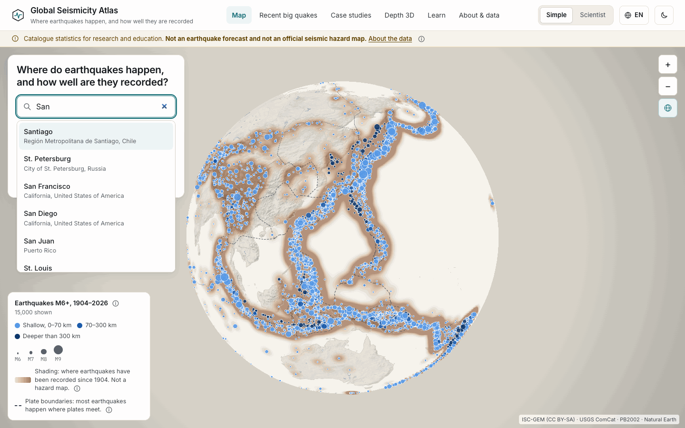
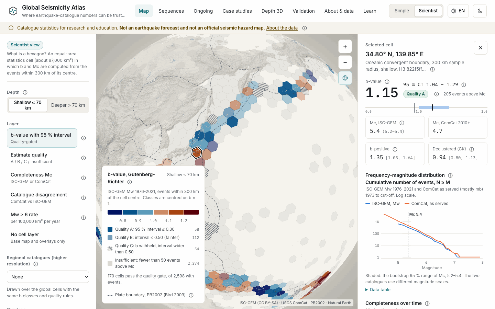
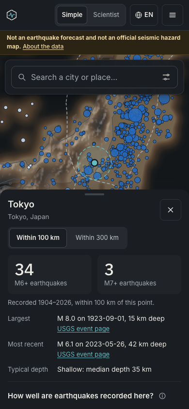
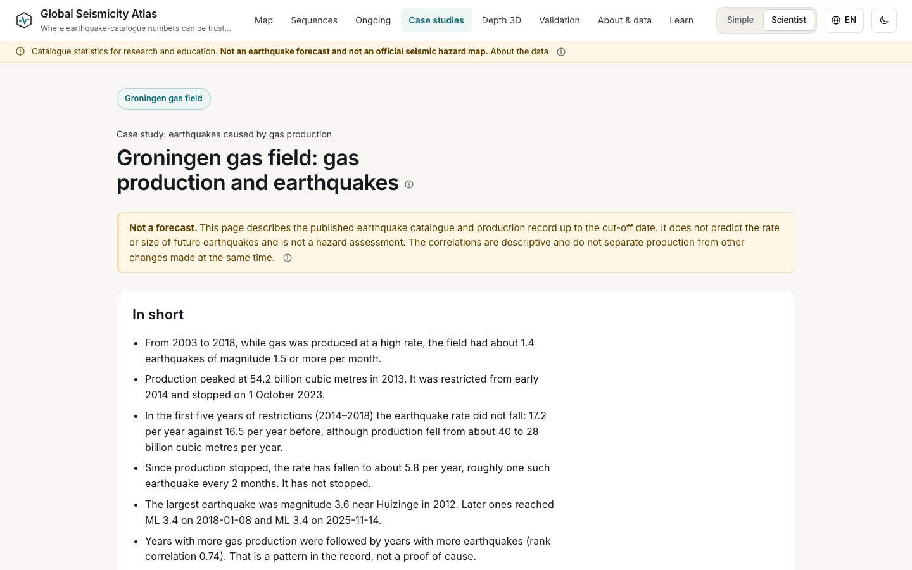
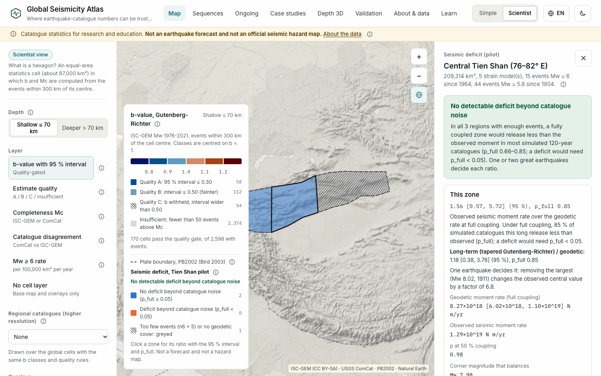
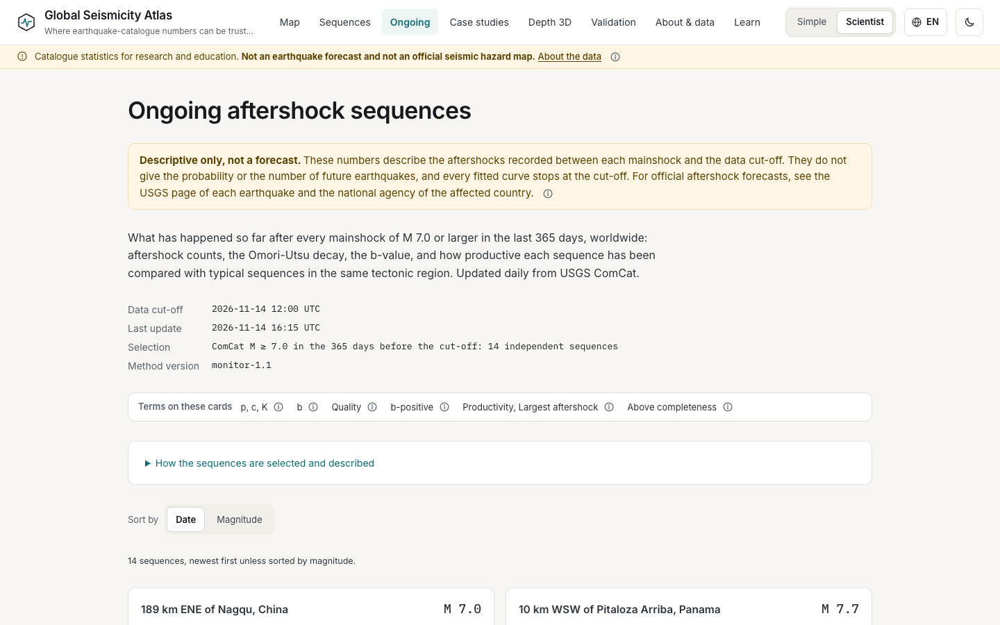
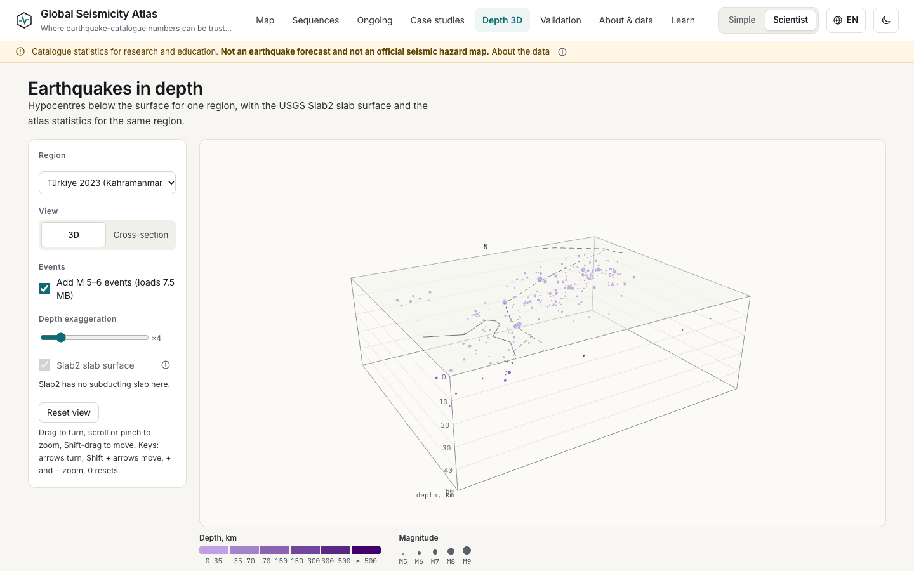
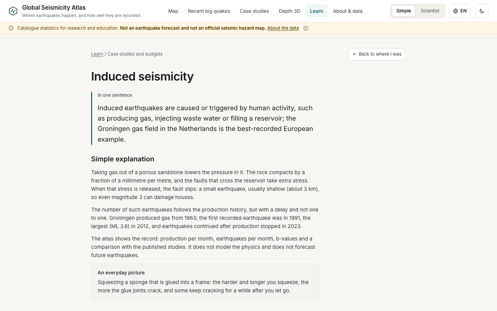

# Global Seismicity Atlas

[](https://doi.org/10.5281/zenodo.24228387)
[](https://doi.org/10.31223/X5X23M)

**Live site: https://seismicityatlas.org/**

An open, reproducible world map of earthquake-catalogue statistics, built from free global catalogues (ISC-GEM and
USGS ComCat). For each place it gives the amount of seismicity, the magnitude of completeness (Mc) and how it changed,
the Gutenberg-Richter b-value **with its 95 % interval and a quality code**, how well the two catalogues agree, and
Omori-Utsu decay of the largest aftershock sequences. The main message is **where the catalogue numbers can be
trusted, and where they cannot.**

The site opens in a **Simple view** for everyone (recorded earthquakes, a place search and a plain-language place
card) on a globe; the **Scientist view** holds the cell statistics behind it. Both run in English, Uzbek, Russian and
Spanish.

> **Not a forecast. Not a hazard map.** These are descriptive statistics of earthquake catalogues, for research and
> education. They do not predict earthquakes and must not be used in place of an official seismic hazard assessment.



<!-- key-results:start -->
## Key results (data cut-off 2026-11-13)

Generated from the data files by `scripts/readme_numbers.py`; do not edit by hand.

| | Value |
|---|---|
| Events analysed | ISC-GEM 74,153 (1904–2021); ComCat M ≥ 4.5: 294,223 (1973–2026-11-12) |
| Duplicates | 58,666 of 58,982 ISC-GEM events in 1973–2021 matched in ComCat (99.5 %); median offset 1.1 s, 9.6 km |
| Global b, ISC-GEM direct Mw 1976–2021 | shallow ≤ 70 km: **1.035 [1.018, 1.052]**; deeper: **0.936 [0.911, 0.961]** |
| Cells with a trusted b (95 % interval ≤ 0.5 × b) | 172 shallow and 71 deeper, out of 2,598 cells that hold events |
| Global completeness (ISC-GEM direct Mw, shallow) | Mw 5.8 for 1976–2003, 5.3 for 2004–2021 |
| USGS M4.5+ feed, as served | median Mc 4.7 (mostly mb) over 956 shallow cells, 2010 to the cut-off |
| Omori fits | 40 sequences since 1990: 17 quality A, 10 B, 8 C, 5 insufficient |
<!-- key-results:end -->

## Validation (ours vs published)

Since v0.5.0 a comparison is a **match** only when z = (ours − published) / √(σ_ours² + σ_pub²) has |z| ≤ 1.96, with
the published uncertainty. Without a published uncertainty, a published value inside our interval is only
**consistent, uninformative**. Each row also says whether the published number comes from the **same data**
(GCMT moments, the source of most ISC-GEM direct Mw after 1976, or ISC-GEM itself) or from **independent data**.
Agreement on the same data shows that the code reproduces the published estimator, not that the result is
independently confirmed.

| Test | Ours | Published | Data | Verdict |
|---|---|---|---|---|
| Global b, deep, 1964–2009 | 0.997 [0.962, 1.033] | 0.99 (Michael 2014, no uncertainty given) | same (ISC-GEM) | consistent, uninformative |
| Global b, shallow, 1918–2009 | 1.078 [1.056, 1.101] | 1.05 (Michael 2014) | same (ISC-GEM) | differs: 1.05 is outside our interval |
| Mc, deep, 1964–2009 | 5.7 [5.4, 5.7] | 5.7 (Michael 2014) | same (ISC-GEM) | consistent, uninformative |
| Mc, shallow, 1964–2009 (three periods) | 5.2–5.7 | 5.7–6.0 (Michael 2014, catalogue v1) | same (ISC-GEM) | differs: ours 0.3–0.5 lower (newer release; ISC-GEM Mc reflects its inclusion thresholds) |
| b, subduction boundaries | 0.971 [0.949, 0.994] | 0.98 (β 0.654, Kagan & Jackson) | same (GCMT) | consistent, uninformative |
| b, global 1982–2008, m ≥ 5.6 (TGR) | 1.035 [1.010, 1.058] | 1.016 (Kagan 2010, no uncertainty given) | same (GCMT) | consistent, uninformative (v0.4 "match" assumed a zero published uncertainty) |
| b, oceanic spreading ridges | 1.480 [1.409, 1.562] | 1.2–1.65 (β 0.8–1.1, Kagan 2002) | same (GCMT) | consistent, uninformative |
| b, Chile box at Kagan & Jackson settings | 0.871 [0.761, 1.015] | 0.855 ± 0.06 (Andean S. America, GCMT) | same (GCMT) | match (z +0.18) |
| b, 10 subduction regions and the 18-zone total (Kagan & Jackson 2013, Table 1) | TGR, mostly on approximate boxes | β ± σ per entry | same (GCMT) | 11 of 11 match (\|z\| ≤ 1.12) |
| b, young vs old subducting slabs | 0.899 vs 1.067 (intervals do not overlap) | b increases with slab age (Nishikawa & Ide 2014, ANSS catalogue) | independent | consistent, uninformative (direction only) |
| b, California | 0.921 [0.746, 1.156] | ≈ 1.0 (Hutton et al. 2010, SCSN) | independent | consistent, uninformative (wide interval) |
| b, Italy | 29 events above Mc | ≈ 1.0 | independent | not testable |
| Synthetic cells, 100–1000 events, one period / two periods | mean error −0.010 / −0.020 (se 0.007) | true b | independent (synthetic) | match (z −1.48) / differs (z −2.78) |
| Omori p, 20 synthetic sequences | 1.063 (se of the mean 0.006) | 1.05 | independent (synthetic) | differs (z +2.31): a bias of +0.013, half the σp of one fit |

Verdict counts over the 45 rows of the site table: same data, GCMT-based 13 match, 6 consistent-uninformative,
1 differs; same data, ISC-GEM itself 2 consistent-uninformative, 9 differs; independent data 1 match,
3 consistent-uninformative, 2 differs, 3 not testable, 1 reference only; no published value 4. **No published
value from independent data is confirmed with a z-test**: the independent rows are either synthetic, without a
published uncertainty, or not testable. Full tables and the reasons for each verdict:
[docs/validation.md](docs/validation.md). Since v0.2, b uses direct (measured) Mw only; converted Ms and mb are left
out of every b ([method §2.1](docs/method.md)).

## What changed in v0.5.0

A method release after a review; same data cut-off (2026-11-13). Old → new numbers with reasons:
[docs/changes-0.5.md](docs/changes-0.5.md).

- **Quality gate on the relative width** (hi − lo) / b: A ≤ 0.30, B ≤ 0.50. The old absolute limits favoured
  low b, because the width grows with b: the 24 cells newly shown have median b 1.265 (shallow) and 1.252 (deeper),
  the 24 newly hidden had 0.833 and 0.825. Shallow cells shown 170 → 172, deeper 73 → 71; the global b is unchanged.
- **1000 bootstrap replicates** (200 before) for every published interval.
- **Validation verdicts by z-score** with both uncertainties, "consistent, uninformative" where the publication
  gives none, and a same-data / independent-data tag on every row.
- **Mc caveat:** ISC-GEM is a selected catalogue with period-dependent inclusion thresholds, so its MAXC Mc
  reflects the inclusion rule rather than network sensitivity ([method §3](docs/method.md)).

## What changed in v0.4.0

Licences, attribution and journal figures; **the atlas numbers are those of v0.3.1** (same data cut-off,
2026-11-13). The data version moves to 0.4.0 because `site/data/` changed shape: regional layers gained `fetched_utc`,
and the Groningen `rates.json` no longer carries epicentres.

- Both licences declared in the citation metadata (code MIT, data CC BY-SA 4.0); full ISC-GEM attribution
  (© ISC and GEM Foundation, CC BY-SA 3.0) on the site, in the README and in `manifest.json`; the exceptions
  (PB2002 ODC-BY 1.0, Natural Earth public domain, Slab2 CC0, GEM aggregates) stated.
- About page: an "as is" disclaimer and privacy and accessibility notes in four languages; three.js and the Crameri
  colour maps credited.
- Literature values re-read from the source PDFs, with page references (`docs/literature-values.md`).
- Journal figures in `docs/img/paper/` without titles, at least 300 dpi at 86 or 180 mm, checked for colour-vision
  deficiency.
- Author ORCID iD in `CITATION.cff` and `.zenodo.json`.

## What changed in v0.3.x

**v0.3.1** (website and new science; the atlas statistics are those of v0.3.0):

- **Case studies: Groningen gas field.** Induced seismicity in the best-recorded European example: a plain-language
  summary first, then monthly gas production and earthquake rate (two charts on one time axis), phase rates with
  Poisson intervals, b by phase from three estimators, moving b-positive for the north and south, b maps by period and
  the comparison with published studies (15 rows). KNMI catalogue (doi:10.21944/e970fd34-23b9-3411-b366-e4f72877d2c5)
  and NLOG.NL production; no event list is offered for download (`rates.json` keeps origin time, ML and KNMI id of
  the 16 events of ML ≥ 3.0, without locations, for the plain-language summary). [docs/induced.md](docs/induced.md)
- **Seismic-deficit layer, Tien Shan pilot** (Scientist view). Released seismic moment against the GNSS/InSAR moment
  rate at full coupling, per region or H3 cell. A ratio is never shown without its 95 % interval and p_full; zones with
  few events are greyed. Conclusion: **no detectable deficit beyond catalogue noise.** [docs/deficit.md](docs/deficit.md)
- **Ongoing cards:** a second productivity reference, ETAS fits to global subduction sequences (Zhang & Werner 2020),
  next to Page et al. (2016), so a "more productive" label is read in context.
- **Depth 3D:** a Türkiye 2023 (Kahramanmaraş Mw 7.8 and 7.6) preset, with a link to the Lomax (2023) relocations.
- **Learn:** two new concepts, induced seismicity and the seismic moment budget (21 concepts in four languages).
- **Colour:** the light-theme b classes are steps of the Crameri Scientific colour map *vik*; it passed the dataviz
  validator where the old palette did not. Dark theme unchanged (no Crameri map passed there).
  [docs/ux-notes.md](docs/ux-notes.md)
- **Paper figures** with Crameri maps, no titles, at least 300 dpi at journal widths: `scripts/paper_figures.py` → `docs/img/paper/`.

**v0.3.0:** the two modes, the globe by default, Learn pages with (i) buttons, the Sequence Monitor, relief and 3D,
and a lighter first load. Full list: [CHANGELOG.md](CHANGELOG.md).

## Website

`site/` is a static site (no build step) served by GitHub Pages. Views:

- **Map, Simple view:** earthquakes M ≥ 5/6/7 as dots coloured by depth over a density shading, offline place search
  (Natural Earth, 7,342 places), a place card with counts, the largest and latest event and a recording rating.
- **Map, Scientist view:** b with its interval and quality code, Mc, catalogue disagreement, M6+ rate; shallow or deeper;
  a cell panel with FMD, Mc over time, b against cutoff and CSV download; a comparison of two cells; regional
  catalogues; the seismic-deficit layer.
- **Ongoing** ("Recent big quakes"): every M ≥ 7 mainshock of the last 365 days, updated daily, descriptive only.
- **Case studies:** Groningen. **Depth 3D:** hypocentres with Slab2 for seven regions or the map view.
- **Sequences** and **Validation** (Scientist view), **About & data**, and **Learn** (one page per concept).

The state (view, layer, cell, language, mode, projection) is kept in the URL hash. MapLibre GL JS 5.24.0, three.js
0.170.0, Inter and IBM Plex Mono are vendored; no CDN, and no third-party tiles except the optional 3D terrain.
Design notes: [docs/ux-notes.md](docs/ux-notes.md); open issues: [docs/known-issues.md](docs/known-issues.md).

| | |
|---|---|
|  |  |
|  |  |
|  |  |
|  | |

## Documentation

- [docs/method.md](docs/method.md): method choices with their reasons, and limitations
- [docs/validation.md](docs/validation.md): synthetic, global, regional and plate-boundary tests
- [docs/data.md](docs/data.md) and [docs/data-schema.md](docs/data-schema.md): sources and the data contract of `site/data/`
- [docs/monitor.md](docs/monitor.md): the Sequence Monitor, its validation and limits
- [docs/induced.md](docs/induced.md): the Groningen case study; [docs/deficit.md](docs/deficit.md): the deficit layer
- [docs/comparisons.md](docs/comparisons.md), [docs/bpositive.md](docs/bpositive.md), [docs/regional.md](docs/regional.md),
  [docs/literature-values.md](docs/literature-values.md): further comparisons
- [docs/learn.md](docs/learn.md): the Learn pages and where each (i) button points
- [docs/release.md](docs/release.md): versions, the monthly update and how the README stays current
- [docs/prior-work.md](docs/prior-work.md), [docs/ai-in-seismology.md](docs/ai-in-seismology.md): context

## How to run

```bash
python3 -m venv .venv && .venv/bin/pip install -r requirements.txt
./scripts/run_all.sh        # downloads about 75 MB once (cached in data/raw/), then builds everything and runs the tests
cd site && python3 -m http.server 8000   # preview the site at http://localhost:8000/
```

- Downloads are treated as untrusted data: parsed as CSV/JSON only, and Python always runs with `-I`.
- Sequence Monitor: `scripts/monitor/build_monitor.py` (daily workflow `update-monitor.yml`); Groningen:
  `scripts/induced/`; deficit layer: `scripts/deficit/` (see the docs above).
- README numbers: `.venv/bin/python -I scripts/readme_numbers.py --write` (run by `run_all.sh`; checked by
  `tests/test_readme.py`).
- README screenshots: `python tests/e2e/tools/readme_shots.py [--chromium PATH]` (Playwright and Pillow; fixed viewport,
  time zone, theme and data; refreshed on each release).
- Paper figures: `.venv/bin/python -I scripts/paper_figures.py` (written at 400 dpi, `docs/img/paper/`).
- Search-engine pages: `node scripts/seo_pages.mjs` writes one static page per Learn concept and language
  (`site/learn/`, `site/{uz,ru,es}/learn/`), `site/sitemap.xml` and `site/robots.txt`; the social card is
  `python tests/e2e/tools/og_image.py`.
- Tests: `.venv/bin/python -I -m pytest -q tests --ignore=tests/e2e`; browser tests: `pip install playwright pytest &&
  python -m playwright install chromium && python -m pytest tests/e2e` (`E2E_BROWSERS=chromium,firefox,webkit` for all
  three engines). CI: `.github/workflows/test-site.yml`.

## How to cite

The method and results are described in a paper (preprint, not peer reviewed; submitted to Seismica):

> Ismoilov, O. (2026). A reproducible global atlas of earthquake-catalogue completeness and b-value with uncertainty. EarthArXiv. https://doi.org/10.31223/X5X23M

For the data and code, cite the archived release on Zenodo: **doi:[10.5281/zenodo.24228387](https://doi.org/10.5281/zenodo.24228387)**
(this concept DOI always resolves to the latest version; v0.4.0 is
[10.5281/zenodo.24254373](https://doi.org/10.5281/zenodo.24254373)). The full metadata is in [CITATION.cff](CITATION.cff)
(GitHub shows a "Cite this repository" button). Also cite the underlying catalogues listed below, and quote the data
cut-off date shown on the site.

## Contributing

Issues and pull requests are welcome, especially published regional b-value or Mc estimates that can be added to the
validation table (with the paper, the magnitude type and the completeness used).

## Licences

- **Code:** MIT (see `LICENSE`).
- **Data and figures** (`site/data/`, `docs/img/`, `results/`): **CC BY-SA 4.0**. They are derived from the
  ISC-GEM catalogue, which is CC BY-SA 3.0, and ShareAlike carries over. Exceptions:
  - `site/data/plates.geojson`: PB2002 (Bird 2003) via github.com/fraxen/tectonicplates, **ODC-BY 1.0**;
  - `site/data/land.geojson`, `coastline.geojson`, `basemap/` and `places.json`: Natural Earth, **public domain**;
  - `site/data/slab2/`: USGS Slab2, **CC0 1.0**;
  - `results/sci2_gem_hazard.json`: aggregate statistics (counts and medians) computed from the GEM Global Seismic
    Hazard Map, which is **CC BY-NC-SA 4.0**. This file is not covered by the CC BY-SA statement above.
- **Attribution required:**
  - ISC-GEM: © International Seismological Centre and GEM Foundation,
    [CC BY-SA 3.0](https://creativecommons.org/licenses/by-sa/3.0/). Used as served by USGS ComCat (`catalog=iscgem`,
    version not stated by ComCat, events to 2021-12-31). Cite International Seismological Centre (2026), ISC-GEM
    Earthquake Catalogue, doi:10.31905/D808B825; Storchak et al. (2013), SRL 84(5), 810–815; Storchak et al. (2015),
    PEPI 239, 48–63; Di Giacomo et al. (2018), ESSD 10, 1877–1899.
  - U.S. Geological Survey ComCat (U.S. public domain).
  - Plate boundaries: Bird (2003), G3 4(3), 1027, via github.com/fraxen/tectonicplates (ODC-BY 1.0).
  - Natural Earth (public domain).
  - Slab2: Hayes et al. (2018), Science 362, 58–61, doi:10.1126/science.aat4723; data doi:10.5066/F7PV6JNV (CC0 1.0).
  - Optional 3D terrain only: Terrain Tiles on AWS Open Data (Tilezen Joerd sources; the full credit list is shown on
    the map and in [docs/basemap.md](docs/basemap.md)).
  - Groningen case study: Royal Netherlands Meteorological Institute (KNMI), Netherlands Seismic and Acoustic Network,
    doi:10.21944/e970fd34-23b9-3411-b366-e4f72877d2c5 (CC BY 4.0; derived aggregates, plus origin time, ML and KNMI id
    of the 16 events of ML ≥ 3.0, without locations); production and field outline: Source: NLOG.NL.
  - Regional layers: INGV ISIDe (CC BY 4.0), GeoNet (CC BY 3.0 NZ), Icelandic Met Office (CC BY 4.0, with the download
    date) and the Southern California Seismic Network via ComCat (no licence stated; cite doi:10.7914/SN/CI and SCEDC,
    doi:10.7909/C3WD3xH1). Details in [docs/regional.md](docs/regional.md).
  - Seismic-deficit layer: strain rates of Ou et al. (2026), doi:10.5281/zenodo.20293601, and Chang (2025),
    doi:10.5281/zenodo.16547905 (both CC BY 4.0).
  - Colour maps: Crameri, F. (2023), Scientific colour maps 8.0.1, doi:10.5281/zenodo.8409685 (MIT licence).
  - Software in `site/vendor/`: MapLibre GL JS 5.24.0 (BSD-3-Clause), three.js 0.170.0 (MIT), Inter and IBM Plex Mono
    (SIL OFL 1.1); each with its licence file.
- **Linked only:** the Lomax (2023) NLL-SSST-coherence relocations of the 2023 Türkiye sequence,
  doi:10.5281/zenodo.8089273 (CC BY 4.0; not redistributed here).
- **Not redistributed:** the GEM Global Seismic Hazard Map (CC BY-NC-SA). The site may link to it only.
- **No warranty.** The data are provided as is, without warranty of any kind. They are not a forecast, an early
  warning or a hazard map, and must not be used for life-safety, engineering, insurance or emergency decisions. For
  official information, consult your national seismological or emergency agency.
