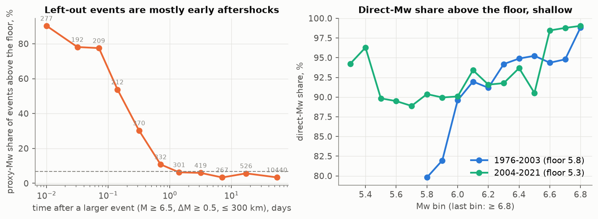
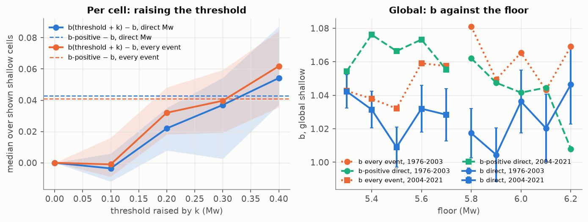
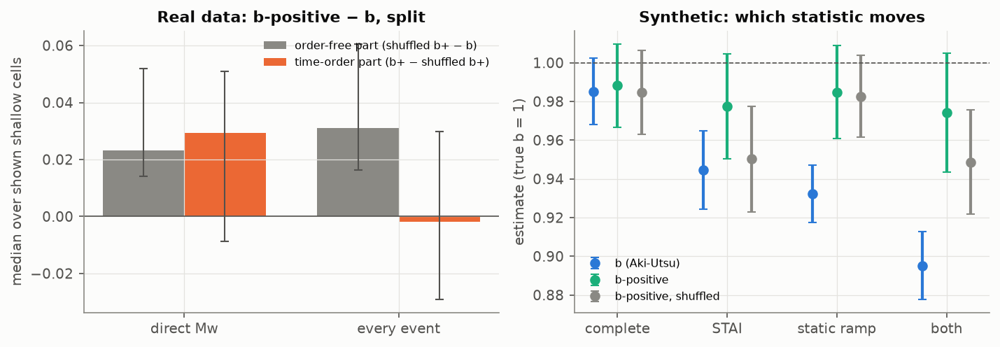

# Why b-positive sits above b on the direct-Mw sample

Since v0.2 the b sample keeps only direct Mw (ISC-GEM magnitude uncertainty 0.10; `method.md` §2.1). Per cell,
b fell (median −0.019) while b-positive barely moved, and the share of shown shallow cells where b-positive lies
inside the b interval fell from 87.8 % to 64.9 %. This page tests why, and whether the floors or the method
should change.

**Answer.** The period floors are not too low for the direct sample, and b-positive has no measurable bias of
its own at these sample sizes. What happened: the proxy-Mw events that v0.2 leaves out are mostly early
aftershocks that GCMT did not resolve. Leaving them out makes the b sample *transiently* incomplete after large
events. That lowers Aki-Utsu b. b-positive, which is built to ignore transient incompleteness, partly makes up
for it. A second, smaller gap was already there in v0.1 and does not depend on the sample. It sits mostly in
non-subduction cells and fits a Gutenberg-Richter distribution that bends at large magnitudes. **No change to the
floors or the estimator is justified.** The atlas b stays as it is, and this page documents what the b-positive
column means.

Everything below comes from `scripts/val_bpos.py` → `results/val_bpos.json` and `docs/img/bpos_*.png`. That
script is part of `scripts/run_all.sh`. "Cells" means the shown (quality A/B) shallow cells of the atlas run that
also have b-positive (≥ 50 differences). The script re-bootstraps the b intervals with its own seed, so its
inside-the-interval shares differ from the atlas's by a few points (direct sample: 68.4 % here, 64.9 % in the
atlas; 63–68 % across seeds tried). Medians carry a 95 % bootstrap interval over cells.

## 1. Literature

**van der Elst (2021)**, *B-Positive: A robust estimator of aftershock magnitude distribution in transiently
incomplete catalogs*, JGR Solid Earth 126, e2020JB021027, doi:10.1029/2020JB021027. Only the abstract was
accessible; the quotes below come from it.

> "The new estimator "b-positive" is based on the positive-only subset of the differences in magnitude between
> successive earthquakes, which are described by a double-exponential (Laplace) distribution with the same
> b-value as the magnitude distribution itself."

> "Here I develop a new estimator of the b-value that is insensitive to transient changes in catalog
> completeness and that does not require data windowing."

> "The b-positive estimator greatly improves the robustness of continuous b-value measurements during active
> earthquake sequences, as well as in historical catalogs with unknown or variable completeness."

The difference threshold he recommends could not be read from the paper itself. The atlas's 0.2 matches the
value Lippiello & Petrillo give (below).

**Lippiello & Petrillo (2024)**, *b-More-Incomplete and b-More-Positive: Insights on a Robust Estimator of
Magnitude Distribution*, JGR Solid Earth 129, e2023JB027849, doi:10.1029/2023JB027849. The quotes come from the
preprint, arXiv:2306.09574 v1.

> "if the detection probabilities of the events i + 1 and i are uncorrelated, the b-positive method is
> counterproductive since it only reduces the statistical sample for the computation of b+ by about 50%."

> "the optimal threshold value for δMth is typically around σT , which is independent of mL and roughly on the
> order of 0.2."

> "We observe that for any value of σR , b+ (δMth , dR ) with dR = 10◦ , which is equivalent to dR = ∞, provides
> a less accurate estimate of btrue compared to b(Mth )." (static network incompleteness)

**Mirwald et al. (2025)**, SeismoStats, Seismological Research Letters, doi:10.1785/0220250266. The quote comes
from arXiv:2511.04521 v2.

> "Although the b-positive method effectively eliminates the effect of short-term aftershock incompleteness, it
> is still affected by normal incompleteness resulting from the detection capabilities of the seismic network
> (Lippiello and Petrillo, 2024). This effect can be reduced by considering only the complete catalog (above
> mc ) before taking the differences, or by increasing the threshold δmc ."

**Lippiello, Godano & Petrillo (2025)**, Seismica 5(2), doi:10.26443/seismica.v5i2.1689. The quotes come from
arXiv:2504.04663 v1.

> "Fig.1 also shows that β+ underestimates βtrue across all values of N+ , except at very large δMth > 3.8"

> "Applying this same analysis to instrumental catalogs, we observe that estimates from β++ are consistently
> higher than those from traditional methods".

**Herrmann & Marzocchi (2021)**, *Inconsistencies and Lurking Pitfalls in the Magnitude–Frequency Distribution
of High-Resolution Earthquake Catalogs*, Seismological Research Letters 92(2A), 909–922,
doi:10.1785/0220200337. This paper introduces Mc-Lilliefors; the software is doi:10.5281/zenodo.4162497.
**Stallone & Spassiani**, *Correcting exponentiality test for binned earthquake magnitudes*, Seismica,
doi:10.26443/seismica.v5i1.2257. In paraphrase: uniform dithering of binned magnitudes does not restore an
exponential and biases Mc-Lilliefors upward, while a truncated-exponential dither inside each bin does restore
it. The atlas's Mc-Lilliefors (`seislib.mc_lilliefors`, `lilliefors_offset`) is an independent implementation
that uses the truncated-exponential dither. No code was copied.

What the literature leaves open: no study was found that measures b-positive against Aki-Utsu on a global
catalogue with mixed magnitude types. None was found on a magnitude-resolution (0.01 vs 0.1) bias of b-positive
either. Both questions are tested directly below.

## 2. Where the left-out events sit

The sample is shallow events above the floor, 1976–2021. An event is an aftershock here if it follows an
M ≥ 6.5 event that is at least 0.5 larger and within 300 km:

| Time after the larger event | Events | Proxy-Mw share |
|---|---|---|
| < 0.02 d (30 min) | 277 | 90.3 % |
| 0.05–0.1 d | 209 | 77.5 % |
| 0.1–0.2 d | 212 | 53.8 % |
| 0.2–0.5 d | 370 | 30.3 % |
| 0.5–1 d | 332 | 10.8 % |
| first day, all | 1,592 | **51.8 %** |
| after the first day | 15,648 | **4.4 %** |

Within its first hours, GCMT misses most aftershocks above the floor; ISC-GEM keeps them with proxy Mw. The
proxy share is also high in 1976 (62 %, the first year of GCMT), and it rises above 13 % in years with great
sequences: 1994–95, and 2010–11 at about 15 %. In 1976–2003 the direct share rises from 80 % at Mw 5.8 to 92 %
at 6.1. In 2004–2021 it is flat at 89–90 % from 5.5 to 6.0. So leaving the proxies out is a **thinning that is
correlated in time**, not a uniform loss.

## 3. (a) Is the floor too low for the direct sample?

- **Per cell.** Raising each cell's threshold by +0.1/+0.2/+0.3/+0.4 changes b by a median −0.004 / +0.022 /
  +0.039 / +0.054 in the direct sample. In the every-event sample at the same floors, the change is −0.001 /
  +0.032 / +0.040 / +0.062. The rise is the same with the proxies in. In the same 76 cells, the direct-minus-every
  gap in b stays at −0.024 / −0.026 / −0.028 / −0.027 / −0.019 from offset 0 to +0.4. If the direct sample were
  incomplete just above the floor, the gap would close within a few tenths. It does not.
- **Global.** On the direct sample, b against the floor is flat within one standard error. For 1976–2003, floors
  5.8–6.2 give 1.017, 1.005, 1.036, 1.020, 1.046 (σ 0.015–0.024). For 2004–2021, floors 5.3–5.7 give 1.042,
  1.032, 1.009, 1.032, 1.028.
- **Mc-Lilliefors, global.** The direct sample of 1976–2003 passes at **5.8**, the atlas floor (p 0.44; 5.7 gives
  p 0.007). Every event passes at 5.7, the v0.1 floor. For 2004–2021, the direct sample and every event both pass
  only at 6.1; 5.8–6.0 give p ≤ 0.013 in both. With 1,600–11,000 events, this is a pooled-shape rejection, not a
  completeness rejection: it is the same with the proxies in. Ten thousand events from many regions are not one
  exponential, and the test detects that.
- **Mc-Lilliefors, per cell** (excesses over each event's own threshold). 61 of 76 cells (80.3 %) pass at the
  atlas threshold; about 90 % would be expected if every cell were complete. Median b above the
  Mc-Lilliefors threshold changes by 0.000, and b-positive minus that b is +0.035. The per-cell test has little
  power, though. Against a detection ramp from 75 % at the floor to 100 % 0.3 above, which lowers b by 0.06, it
  rejects in 22 % of synthetic catalogues of 170 events and 55 % of 600.

**Verdict on (a): rejected as the cause.** Raising the floors moves b by the same amount with or without the
proxies, and never closes the gap to b-positive. Floors of 6.1 for 2004–2021 would cut the sample from 11,261
to about 1,600 events, with no evidence for doing so.

## 4. (b) Time order: the part b-positive sees and b does not

The test shuffles each cell's events in time, separately within each floor period, and recomputes b-positive
(the mean over 400 random orders). A shuffled order destroys any correlation between detection and time, so
shuffled b-positive behaves like an order-free estimator. Real b-positive minus shuffled b-positive is the part
that comes from the time order.

| Sample (same cells per row) | b⁺ − b | time-order part | order-free part | inside share |
|---|---|---|---|---|
| v0.1: every event, v0.1 floors (114 cells) | +0.027 [0.014, 0.040] | +0.007 [−0.011, 0.024] | +0.018 [0.009, 0.034] | 88.6 % |
| every event, v0.2 floors (86) | +0.041 [0.004, 0.050] | −0.002 [−0.029, 0.030] | +0.031 [0.016, 0.061] | 81.4 % |
| **v0.2: direct Mw** (76) | +0.043 [0.019, 0.084] | +0.029 [−0.009, 0.051] | +0.023 [0.014, 0.052] | 68.4 % |

The comparison that settles it is paired, on the same 76 cells. It sets the direct sample against every event at
the same floors:

| Statistic | direct − every |
|---|---|
| b (Aki-Utsu) | **−0.024** [−0.028, −0.019] |
| shuffled b-positive (order-free) | **−0.026** [−0.034, −0.018] |
| b-positive (real order) | −0.011 [−0.026, −0.003] |
| time-order part | **+0.013** [−0.000, +0.028] |

Seen without time order, the proxy removal lowers b-positive exactly as much as it lowers b. In the real order,
b-positive gets about half of that back. This is the signature of transient incompleteness: an event is missing
because a larger one came just before it. On its own the paired time-order term is borderline (its 95 % interval
just touches zero). The case rests on it together with §2 and the synthetic test below. Two further pieces of evidence point the same way:

- Successive pairs within one day give b⁺ − b = +0.113 [0.060, 0.236] on the direct sample (50 cells), against
  +0.017 for pairs more than a day apart.
- Raising b-positive's difference threshold to 0.3 lifts b⁺ − b to +0.086 on the direct sample, but only to
  +0.041 with every event. SeismoStats recommends exactly this remedy for incompleteness.

**Synthetic injection** (20 catalogues; Omori-Utsu sequences, true b = 1, floor 5.3):

| Case | b | b-positive | shuffled b-positive |
|---|---|---|---|
| complete | 0.985 ± 0.017 | 0.988 ± 0.022 | 0.985 ± 0.022 |
| STAI (77 % of first-day aftershocks above the floor missed) | **0.945** ± 0.020 | 0.978 ± 0.027 | **0.950** ± 0.027 |
| static ramp above the floor (75 % → 100 % over 0.3) | **0.932** ± 0.015 | 0.985 ± 0.024 | 0.983 ± 0.021 |
| both | 0.895 ± 0.018 | 0.974 ± 0.031 | 0.949 ± 0.027 |

Both kinds of incompleteness lower b and leave b-positive almost intact. Only short-term aftershock
incompleteness (STAI) also lowers *shuffled* b-positive, so only STAI produces a positive time-order part. The
real direct sample shows that part (+0.013 paired). The every-event sample does not.

**Blind windows do not fix it.** One possible remedy is to drop events within T days after a larger event from
b, while b-positive stays on the full sample:

| T | global b, direct / every | per-cell median b | b⁺ − b | inside share |
|---|---|---|---|---|
| 0 (atlas) | 1.035 / 1.054 | 0.985 | +0.043 | 68.4 % |
| 0.25 d | 1.042 / 1.063 | 0.992 | +0.042 | 68.0 % |
| 1 d | 1.039 / 1.060 | 0.984 | +0.053 | 67.1 % |
| 2 d | 1.036 / 1.056 | 0.980 | +0.060 | 70.1 % |

The windows remove the high-b early aftershocks along with the missing ones, so b barely moves. The
direct-minus-every gap stays at about 0.02 globally, and per cell the gap to b-positive does not close.

**Verdict on (b): confirmed as the cause of the v0.2 change.** It is a property of the GCMT direct-Mw sample
that no floor removes. The published GCMT b-values the atlas is compared with (Kagan 2010; Kagan & Jackson 2013)
come from the same catalogue and share the same aftershock gaps. That is consistent with three literature rows
moving from mismatch to match in v0.2 (`validation.md` §10).

## 5. (c) b-positive's own bias

- **Null test, iid Gutenberg-Richter with b = 1.** The synthetic catalogues have the same per-event floors and
  the same number of events above the floor as each cell, with the atlas estimators, 20 replicates.
  - Magnitudes at 0.01 (1,297 cell draws): median b⁺ − b is **+0.005**, and b⁺ falls inside the b interval in
    **96.8 %** of draws.
  - Magnitudes at 0.1 (1,339): **+0.008** and **96.4 %**.
  - So at these sample sizes the estimator itself contributes nothing measurable. The 64.9 % share in the atlas
    and the 87.8 % share in v0.1 are both *below* this null. The inside share is a diagnostic, not a pass/fail
    test.
- **Resolution.** b-positive computed on 0.01 differences (no 0.1 binning) gives b⁺ − b = +0.059 on the direct
  sample, against +0.043 binned. Binning does not create the gap.
- **One small finding about b itself.** ISC-GEM magnitudes come at 0.01. When they are binned to 0.1, values
  ending in 5 fall on a bin edge, and `bin_mag` rounds 73.9 % of them down (floating point and half-to-even
  rounding). That shifts the effective bin edges up by about 0.002 and lowers Aki-Utsu b slightly. Global
  shallow direct b is 1.035 binned and 1.041 computed on the 0.01 values. This is −0.006, well inside the global
  interval (±0.017), and it affects every b in the atlas equally. b-positive takes differences, so it is
  unaffected. The estimator was not changed; see `known-issues.md`.

**Verdict on (c): rejected.**

## 6. (d) Subduction vs other boundaries

| Sample | Class | Cells | b⁺ − b | time-order part | order-free part | inside |
|---|---|---|---|---|---|---|
| v0.1 | SUB | 83 | +0.017 | +0.007 | +0.012 [0.004, 0.025] | 94.0 % |
| v0.1 | other | 31 | +0.060 | +0.028 | +0.073 [0.036, 0.088] | 74.2 % |
| v0.2 direct | SUB | 56 | +0.038 | +0.024 | +0.018 [0.002, 0.039] | 67.9 % |
| v0.2 direct | other | 20 | +0.055 | +0.036 | +0.063 [0.019, 0.107] | 70.0 % |

- The time-order part appears in both classes in the direct sample; STAI is not specific to subduction zones.
- The order-free part is 4–6 times larger outside subduction zones, in v0.1 as well as v0.2. iid draws show what
  shape does to b⁺ − b:
  - a tapered Gutenberg-Richter law with β = 0.65 gives +0.061 at corner magnitude 7.0, +0.020 at 7.5 and +0.008
    at 8.0;
  - a 50/50 mix of b = 0.8 and b = 1.2 gives −0.033.
- b-positive leans on the larger magnitudes, so it reads higher where the distribution bends. A lower corner
  magnitude away from subduction zones would produce exactly this pattern. This was not fitted per cell, so it
  remains an interpretation.

**Verdict on (d):** the time-order part (the v0.2 change) does not depend on the boundary class. The older
order-free part does, and fits a tapered distribution.

## 7. Decision

No change to the floors, the b sample or the estimators.

- **Floors.** Raising them does not move the direct sample toward b-positive any more than it moves every event
  (§3). The only Mc-Lilliefors value above a floor (6.1 for 2004–2021) applies equally to every event, and it
  would cost about 85 % of the sample.
- **Method.** The v0.2 drop comes from aftershocks that GCMT missed (§4). Blind windows, the standard remedy for
  Aki-Utsu, do not close the gap. Bringing proxies back for early aftershocks only would reintroduce the proxy
  magnitudes v0.2 removed on purpose. Per cell, the effect (about −0.013 from time order, −0.024 in total) is
  small against the median 95 % interval width of the cells with b-positive (0.27).
- **b-positive stays as the robustness column.** Where b⁺ is well above b, the likely reasons are aftershock
  gaps in the direct sample (§4) or a bending distribution outside subduction zones (§6). It is not evidence that
  the cell's Mc is wrong. The drift guard needs no re-centring, because no published number changed.

## Not verified

- The full text of van der Elst (2021) could not be read, so his own recommended Δ threshold is unconfirmed.
- The Herrmann & Marzocchi code was not run. The Mc-Lilliefors here is an independent implementation, with test
  size checked at 9–12 % for α = 0.1 (`tests/test_bpos.py`), and it was not compared value by value with theirs.
- The tapered-distribution reading of the order-free part (§6). No corner magnitude was fitted per cell.
- Whether the proxies of 1976–2003 just above 5.8 are events GCMT missed or proxy magnitudes inflated by
  conversion. b-positive cannot separate these; the per-event source column of the official ISC-GEM file could.
