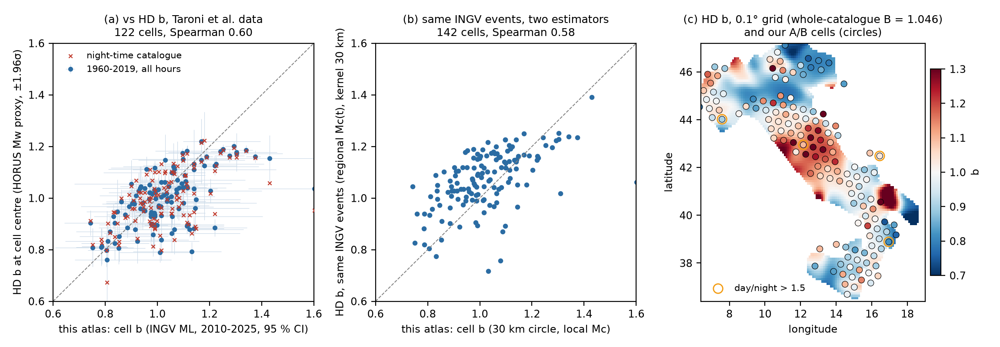

# Comparisons with published maps, parameters and tools

This page compares the atlas with five external references: a published high-definition b-value map of Italy, a
b-value package, the GEM global hazard map, published subduction-zone ETAS parameters and the CSEP testing
framework. Each section gives the licence of the source, what was done, the numbers and a verdict.

Code: `scripts/sci2/` (`sci2lib.py` shared maths, `hd_italy.py`, `ntest_omori.py`, `gem_hazard.py`) and
`scripts/monitor/monitorlib.py` (`zw2020_productivity`). Tests: `tests/test_sci2.py`. Outputs: `results/sci2_*.json`
and `docs/img/sci2-*.png`. Every number below comes from those outputs (runs of 2026-11-14).

| # | Reference | Licence | Used as | Verdict |
|---|---|---|---|---|
| 1 | Taroni, Zhuang & Marzocchi (2021) HD b map of Italy; comment by Gulia, Gasperini & Wiemer (2022) | paper: author accepted manuscript, CC0 1.0 (INGV Earth-prints); input catalogue: subset of HORUS (CC BY 4.0) released in a GitHub repository without a licence | comparison only; files kept in the local cache, not redistributed | our Italy layer agrees in ranks (Spearman 0.62) with no bias (median −0.013); differences are concentrated in the Po Plain and eastern Sicily |
| 2 | pybvalue v0.0.1 | MIT | method re-implemented (the archive holds no b-value code) | agrees with our layer when the same +0.2 completeness correction is used (Spearman 0.87, median +0.003) |
| 3 | GEM Global Seismic Hazard Map v2026.1 | CC BY-NC-SA 4.0 | not redistributed, link only; internal analysis with aggregate statistics only | see §3 |
| 4 | Zhang, Werner & Goda (2020) ETAS parameters | journal article; parameters quoted as facts | optional data fields of the monitor | see §4 |
| 5 | Savran et al. (2020); pyCSEP | pyCSEP BSD-3-Clause | the Poisson N-test re-implemented (same definition) for a retrospective check | see §5 |

## 1. Italy: high-definition b map (Taroni et al. 2021) and the quarry-blast debate

### Sources and licences

- Taroni, M., Zhuang, J., Marzocchi, W. (2021), SRL 92(6), doi:10.1785/0220210017. Read from the accepted manuscript
  on INGV Earth-prints (handle 2122/14709, CC0 1.0).
- Gulia, L., Gasperini, P., Wiemer, S. (2022), comment, SRL, doi:10.1785/0220210159. Read from the authors' draft on
  Earth-prints (handle 2122/16217); it includes their response to the reply. The reply by Taroni et al.
  (Earth-prints handle 2122/16330) is behind a login and was **not read**.
- The paper publishes the b map only as a figure; there is no gridded data file or supplement with values. The
  authors released their MATLAB code, the input catalogue (56,309 events, a HORUS subset with a per-event
  completeness column) and a night-time version of it at github.com/MatteoTaroniINGV/BvalueMapping (commit
  `cb98a57`). The repository has **no licence**, so the files are downloaded to the local cache for comparison only
  and are not redistributed. HORUS itself (Lolli et al. 2020, horus.bo.ingv.it) is CC BY 4.0.

### Method

Their estimator (eqs. 4–5 of the paper and `BvalueMappingWLEstimationMCvariation.m`) is a weighted maximum
likelihood: every event gets a Gaussian weight w = exp(−r² / 2σ²), σ = 30 km, around each 0.1° grid point, and

b = Σw / (ln10 · Σw (M − Mc + ΔM/2)),  σ_b = b · √(Σw²) / Σw,

with each event's own completeness Mc (fixed per period for the whole of Italy: 4.0 in the 1960s down to 1.8 after
2005) and ΔM = 0.01. A cell is "significantly different" when the whole-catalogue B lies outside b ± 1.96 σ_b. We
re-implemented this in `sci2lib.b_wle` (no code copied; checked against the classical MLE and a two-region synthetic
in `tests/test_sci2.py`).

Our layer differs in five ways: INGV ML (theirs is a Mw proxy), 2010–2025 (theirs 1960–2019), depth ≤ 70 km (≤ 30),
a hard 30 km circle (a Gaussian kernel with σ = 30 km, so about two thirds of the weight lies within 45 km) and a local Mc per cell and
period with 200-event windows (one Mc per period for all of Italy, plus removal of events within 3 days and 30 km
after every M ≥ 5.5).

### Reproduction

| | Ours (re-implementation) | Published |
|---|---|---|
| events in the input catalogue | 56,309 | 56,309 |
| whole-catalogue B | **1.046 ± 0.004** | 1.04 |
| night-time catalogue | 30,802 events, B = 1.047 | – |

The published value is given to two decimals; ours is 0.006 higher (1.4 σ). Their map was not published as numbers,
so the grid itself (4,074 points; b from 0.50 to 1.51, median 0.97) can only be compared with their Figure 2 by
eye: the high-b areas in the central Apennines, northern Apulia and western Tuscany and the low-b areas in western
Sicily and the north-east are reproduced (panel c of the figure).

### Cell-by-cell comparison

At the centre of every Italian cell where our shallow b is shown (144 cells, quality A or B) we evaluated their
estimator directly (no interpolation). 120 centres lie inside their study polygon (within 8 km of one of their grid
points); all have an effective sample size (Σw)²/Σw² ≥ 50. "Difference" is theirs minus ours.

| Comparison (n cells) | Pearson r | Spearman ρ | Median difference | RMS difference |
|---|---|---|---|---|
| ours vs HD, their catalogue 1960–2019 (120) | 0.68 | **0.62** | **−0.013** | 0.10 |
| ours vs HD, their catalogue 2010–2019 only (120) | 0.68 | 0.63 | +0.013 | 0.11 |
| ours 2010–2019 vs HD 2010–2019 (same years) (120) | 0.64 | 0.62 | +0.017 | 0.12 |
| ours vs HD, their night-time catalogue (120) | 0.63 | 0.57 | −0.003 | 0.11 |
| ours vs HD, their catalogue with 30 days removed after M ≥ 5.5 (120) | 0.70 | 0.63 | −0.010 | 0.10 |
| ours vs HD on **our own events** (regional Mc(t), same removal rule) (144) | 0.61 | 0.60 | +0.076 | 0.13 |

Their significance map against our intervals (our median cell b 0.996 as the reference): of the 23 cells where their
b is significantly above their B, ours is also above the median in 15 and below it in none; of the 52 cells
significantly below, ours is below in 14 and above in 3.

Where we differ most (standardised difference, `results/sci2_italy_hd.json`):

| Area (cell centre) | Ours [95 %] | HD, theirs | HD, theirs, 30-day removal | HD, night-time |
|---|---|---|---|---|
| Po Plain / Emilia, 45.00 N 10.88 E | 1.13 [0.93, 1.23] | 0.79 | 0.83 | 0.86 |
| northern Apennines, 44.70 N 10.47 E | 1.21 [1.09, 1.33] | 0.89 | 0.91 | 0.94 |
| Po Plain, 44.78 N 9.90 E | 1.13 [0.99, 1.27] | 0.88 | 0.88 | 0.95 |
| Po Plain / Emilia, 44.91 N 11.45 E | 1.01 [0.86, 1.15] | 0.79 | 0.81 | 0.86 |
| central Sicily, 37.53 N 14.38 E | 1.11 [0.88, 1.23] | 0.89 | 0.89 | 0.91 |
| Etna, 37.71 N 15.31 E | 1.11 [1.00, 1.16] | 0.90 | 0.90 | 0.90 |
| northern Marche coast, 43.94 N 12.85 E | 0.96 [0.80, 1.07] | 1.11 | 1.11 | 1.09 |
| Basilicata / Apulia, 40.55 N 16.49 E | 1.42 [1.12, 1.57] | 1.15 | 1.16 | 1.06 |

*(a) Our cell b against their estimator on their catalogue at the same centres (blue: all hours, red: night-time
catalogue). (b) Our b against the HD estimator on our own events. (c) The HD grid recomputed from their catalogue
(squares) and our A/B cells (circles), same colour scale; orange rings: day/night ratio > 1.5 in our data. HD values
computed by us from the catalogue of Taroni et al. (2021), a subset of HORUS (Lolli et al. 2020, CC BY 4.0).*

What this shows:

- **No overall bias, moderate rank agreement.** Over 120 cells the median difference is −0.013 and the rank
  correlation 0.62. This holds for the full and the overlapping period (2010–2019), so the 50 extra years of their
  catalogue do not drive the agreement or the differences. Part of the scatter is expected because ML b and Mw b
  differ by the slope of the ML–Mw relation; the ranks are the like-for-like part.
- **The two estimators on the same events agree only as well as the two catalogues do** (ρ 0.60). The kernel
  estimate is smoother (spread of cell values 0.11–0.12 against 0.13 for ours) and higher by 0.08 in the median. The
  higher level comes from the completeness: with one Mc per period for all of Italy (2.1–2.3) instead of a local
  MAXC + 0.2, fewer small events are used and the curved part of the frequency-magnitude distribution near the
  threshold is excluded differently. The method, not the data, explains most of the cell-to-cell differences.
- **Where they differ.** The Po Plain and northern Apennines (our b 1.0–1.2, HD 0.79–0.89) and eastern Sicily are
  the largest differences. Removing 30 days instead of 3 after M ≥ 5.5 raises the HD value in Emilia only from 0.79
  to 0.83, so the 2012 Emilia aftershocks are not the whole reason. These are areas where a national Mc(t) and a
  local Mc differ most (Schorlemmer et al. 2010 map uneven detection in Italy); Taroni et al. themselves attribute
  low b in poorly covered areas to a common Mc. Our values there carry wide intervals (0.86–1.33).

### The methods debate, and what it implies for our layer

- **HD / weighted likelihood vs fixed radius.** Taroni et al. argue that a kernel avoids the hard edge of a fixed
  radius, gives a formal uncertainty for the weighted estimate (delta method), and that a spatially varying b beats a
  uniform B in a pseudo-prospective test (training 1960–2009, testing 2010–2019; Bayes factor curves for Mc 1.8,
  2.1 and 2.4, strongest gain during Amatrice–Norcia 2016). They list a better space-time Mc as the main open
  improvement.
- **Gulia, Gasperini & Wiemer (2022).** They argue that the high-b anomalies are dominated by quarry blasts that
  remain in the catalogue: in 20 km circles at three high-b areas (43.35 N 13.2 E, 43.35 N 13.1 E, 40.7 N 16.7 E)
  the day/night ratio is "ranging from 1.7 to 26"; a ratio of 1.5 "is already indicative of significant quarry blast
  contamination" (Wiemer & Baer 2000); the maximum magnitude of European blasts is about 2.5, above the 1.8 Mc used
  after 2005. High b in western Tuscany is attributed to an edge effect at the fringe of seismicity. In their
  response they find that in the night-time map the Apulia anomaly "disappears entirely" and one Marche anomaly is
  "substantially reduced". They also note that blast discrimination by INGV improved after 2012.
- **Our layer under the same check.** We excluded the 2,507 events that INGV flags as quarry blasts (plus other
  explosion types). For the events above each cell's thresholds, the day/night ratio (07–19 vs 19–07 CET) has a
  median of 0.99 (p10–p90 0.82–1.27) over the 144 shown cells; 5 cells exceed 1.5 and 1 exceeds 2. It does not
  correlate with b (r = −0.07). In 20 km circles at the three comment areas our ratios are 0.95, 0.97 and 0.86
  (80, 77 and 13 events above the regional floor). Recomputing b with night-time events only (100 cells keep
  quality A/B) changes the median cell by −0.006, and 11 of the 100 night values fall outside the all-hours
  interval. **We find no quarry-blast signature in the shown cells.** This is consistent with the comment's own
  remark on better discrimination after 2012 and with our 2010–2025 window; it does not prove that no blast remains
  in cells with few events.
- **Implications.** (1) Our fixed-radius b with a local Mc and the published kernel b give the same large-scale
  pattern; cell-level differences of about 0.1 are within the method spread and should not be interpreted. (2) The
  completeness model matters more than the kernel. (3) The event-type filter is necessary: it stays, and the
  day/night ratio is now a documented check. (4) A cell value is not a seismotectonic finding by itself; the debate
  shows how easily non-physical effects (blasts, edge effects, completeness) create anomalies.

## 2. pybvalue cross-check

- **Package and licence.** pybvalue v0.0.1, N. Thapa (2024), doi:10.5281/zenodo.11508511, **MIT** (LICENSE file in
  the Zenodo archive). The linked GitHub repository returned 404 on 2026-11-14.
- **What it contains.** The archive holds a README, the licence, a project description (PDF), one notebook and two
  catalogue files. The notebook only downloads and reads catalogues; **there is no b-value or Mc function** to run.
- **Method as documented** (README and ProjectDescription.pdf): Mc by maximum curvature; the Aki (1965) maximum
  likelihood b with the bin correction; the Shi & Bolt (1982) uncertainty; spatial mapping after Schorlemmer et al.
  (2004).
- **Re-implementation.** `sci2lib.b_single_mc`: one MAXC Mc per circle over the whole window, Aki–Utsu, Shi–Bolt, on
  exactly the circles and events of our Italy layer (144 shallow A/B cells). Output: `results/sci2_pybvalue.json`.

| Single-Mc variant | n | Pearson r | Spearman ρ | Median difference (single − ours) | RMS | Inside our 95 % interval |
|---|---|---|---|---|---|---|
| MAXC (as documented) | 144 | 0.78 | 0.77 | −0.068 | 0.11 | 107 (74 %) |
| MAXC + 0.2 | 143 | 0.87 | 0.87 | +0.003 | 0.07 | 132 (92 %) |

**Verdict:** with the same +0.2 correction our time-varying estimator and a single-Mc estimator agree closely
(median +0.003). The documented MAXC without correction gives b lower by 0.07, the known downward bias of MAXC
(Woessner & Wiemer 2005; Mignan & Woessner 2012), which is why the atlas uses MAXC + 0.2. The single-window Mc is
0.2 lower than our latest-period Mc in the median cell. Global inputs were not run (the Italy cells already test
the estimator on 144 independent circles).
