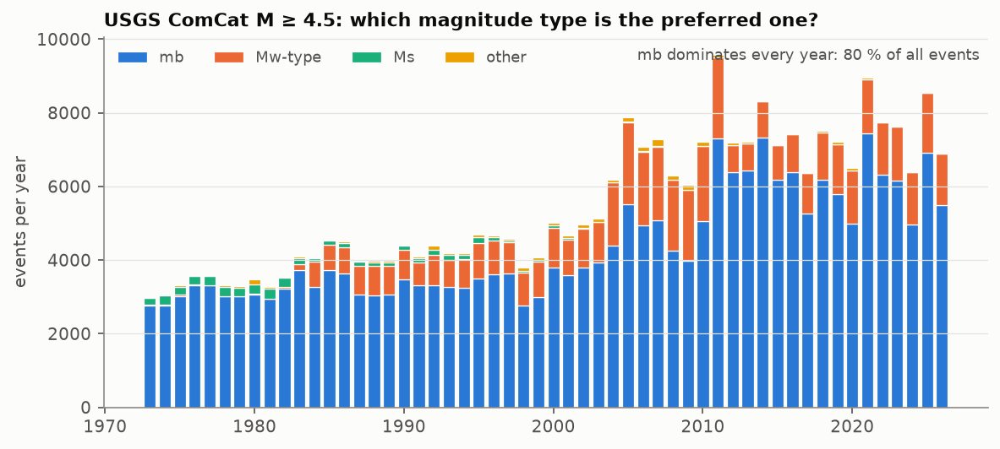
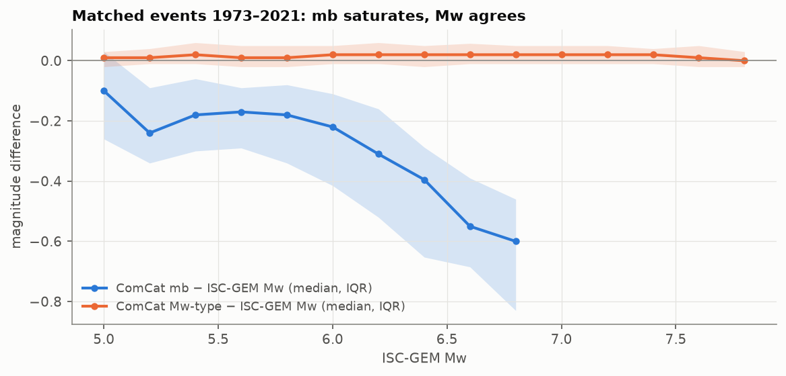
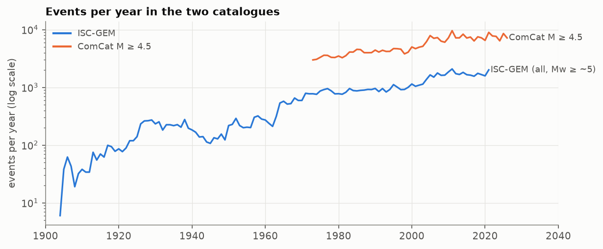
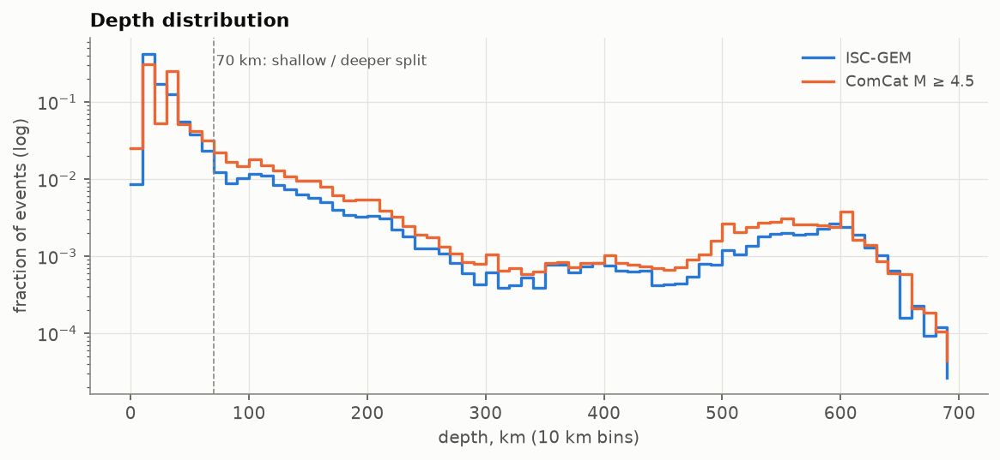

# Data

All numbers below come from `results/prepare.json` and `results/profile.json` (run of 2026-11-13).

## Sources and access

| Catalogue | Access | Span | Events | Licence |
|---|---|---|---|---|
| ISC-GEM Global Instrumental Earthquake Catalogue | USGS ComCat FDSN service, `catalog=iscgem` | 1904-04-04 – 2021-12-31 | 74,153 | CC BY-SA 3.0 |
| USGS ComCat (ANSS Comprehensive Catalog) | FDSN `minmagnitude=4.5`, `eventtype=earthquake`, yearly chunks | 1973-01-01 – 2026-11-12 | 294,222 | U.S. public domain (USGS policy) |
| PB2002 plate boundaries and boundary steps (Bird 2003) | github.com/fraxen/tectonicplates (GeoJSON) | – | 5,824 steps, 7 classes | ODC-BY 1.0 (LICENSE.md checked) |
| Natural Earth land 1:110m, coastline 1:50m | github.com/nvkelso/natural-earth-vector | – | – | public domain |

Notes on access:

- **ISC-GEM version.** The ISC download page (Version 13.0, 21 October 2026) hands the file out only through a
  request form that asks for name, e-mail and affiliation. We did not submit personal data and used the copy that
  ComCat serves. That copy ends on 2021-12-31 and ComCat does not state its ISC-GEM version, so the atlas is
  based on an older release than 13.0. Updating to 13.0 is a manual step for the publisher.
- **ComCat licence.** USGS-authored data are U.S. public domain. We could not re-read the USGS policy page on
  2026-11-13: usgs.gov returned bot-protection pages and timeouts. ComCat also holds contributed origins, and the
  ISC-GEM part keeps its CC BY-SA terms.
- **ComCat row limit.** ComCat refuses queries above 20,000 events (HTTP 400). The fetcher asks for one year at a
  time and splits a chunk in half if it is refused. No yearly chunk reached the limit (largest year: 2011,
  9,584 events).
- **Untrusted input.** Downloads are parsed only as CSV or JSON, all Python runs with `-I`, and every response is
  cached once under `data/raw/` with its URL, size and sha256 in `data/raw/manifest.jsonl`.
- 2 ComCat events have no depth and are dropped. Every row of both downloads has `type = earthquake`.

## Magnitude types

ISC-GEM: every event is listed as `mw` (direct Mw or ISC-GEM's own Mw proxy). The ComCat copy has no direct/proxy
flag; the magnitude uncertainty (`magError`) is the only marker. In 1976–2021, 0.10 marks direct Mw (checked
against GCMT magnitudes in ComCat, `method.md` §2.1), and since v0.2 only those events enter b. Magnitudes run from
4.75 to 9.55.

ComCat preferred magnitudes, all years (M ≥ 4.5):

| Type | Events | Share |
|---|---|---|
| mb | 235,033 | 79.9 % |
| Mw family (mwc 20,369, mww 14,420, mw 10,224, mwr 3,514, mwb 3,177, mwp 8) | 51,712 | 17.6 % |
| Ms | 4,396 | 1.5 % |
| other (ml 1,910, md 802, m 302, mblg 20, mh 15, ...) | 3,055 | 1.0 % |

By decade, mb is the preferred type for 71–92 % of events (lowest in the 2000s, highest in the 1970s). Ms disappears after 2000, and Mw-type magnitudes
grow from 110 events in the 1970s to 16,027 in the 2000s (`docs/img/data_magtypes.png`).

**mb saturates.** For matched events (next section), the median of ComCat mb minus ISC-GEM Mw is −0.10 at Mw 5.0,
−0.22 at 6.0, −0.75 at 7.0 and −1.23 at 8.0 (`docs/img/data_dmag.png`). The two catalogues agree on Mw-type
magnitudes: the median difference is +0.01 and the median absolute difference 0.03 over 38,321 pairs.

## Event counts over time

| Decade | ISC-GEM | ComCat M ≥ 4.5 |
|---|---|---|
| 1900s | 200 | – |
| 1930s | 2,238 | – |
| 1960s | 4,426 | – |
| 1970s | 8,058 | 23,128 (from 1973) |
| 1980s | 8,682 | 39,476 |
| 1990s | 9,464 | 43,102 |
| 2000s | 13,945 | 60,557 |
| 2010s | 17,399 | 75,210 |
| 2020s | 3,589 (2020–2021) | 52,747 (to 2026-11-12) |

## Depth

| | ISC-GEM | ComCat |
|---|---|---|
| ≤ 70 km | 62,936 | 226,614 |
| 70–300 km | 8,369 | 52,375 |
| > 300 km | 2,848 | 15,231 |
| median depth | 23 km | 33 km |
| at a fixed default depth | 10 km: 10,134; 15 km: 11,727; 35 km: 3,144 | 10 km: 77,102; 33 km: 45,846; 35 km: 11,707 |

Common default depths all lie above 70 km, so they cannot move an event across the shallow/deeper split. Up to
46 % of ComCat events and 34 % of ISC-GEM events sit exactly on one of these values, so their depth carries little
information beyond "shallow".

## Duplicates between the catalogues

An ISC-GEM event and a ComCat event are the same if their origin times differ by ≤ 30 s and their epicentres by
≤ 100 km. Pairs are made one-to-one, closest first, using the score (Δt/10 s)² + (Δd/50 km)².

- 58,982 ISC-GEM events fall inside the ComCat span (1973–2021). **58,666 (99.5 %) are matched**, 316 are not.
- Matched pairs: median Δt 1.08 s (90th percentile 2.9 s), median epicentre difference 9.6 km (90th percentile
  21.9 km).
- ComCat events with Mw proxy ≥ 6.0 and no ISC-GEM match, 1973–2021: listed per cell as `c_conly`. There are 94
  events M ≥ 6.0 in the deduplicated event layer that exist only in ComCat before 2022.
- The share of ComCat mb events that have an ISC-GEM match rises with mb: 0.6 % at mb 4.5, 16 % at 5.0, 44 % at
  5.3, 80.5 % at 5.5, 91 % at 6.0. ISC-GEM is therefore a subset of ComCat at small magnitudes, as expected.

## Coverage

- H3 resolution-2 cells (mean area 86,802 km²) holding at least one event: ISC-GEM 1,842, ComCat 2,505, both
  together 2,598.
- Nearest PB2002 boundary step within 200 km, shallow ISC-GEM events, all years: SUB 27,711, OTF 8,296,
  none 7,852, OSR 5,449, CCB 4,425, CTF 3,829, CRB 3,541, OCB 1,833.

## Declustering (Gardner-Knopoff windows)

ISC-GEM: 37,675 of 74,153 events are mainshocks (50.8 %). ComCat (on the Mw proxy): 105,385 of 294,220 (35.8 %).
At these magnitudes the Gardner-Knopoff time windows are long: 10^(0.032 M + 2.7389) days for M ≥ 6.5, which is
about 920 days at M 7. The effect on b is large; see `method.md` §6.
