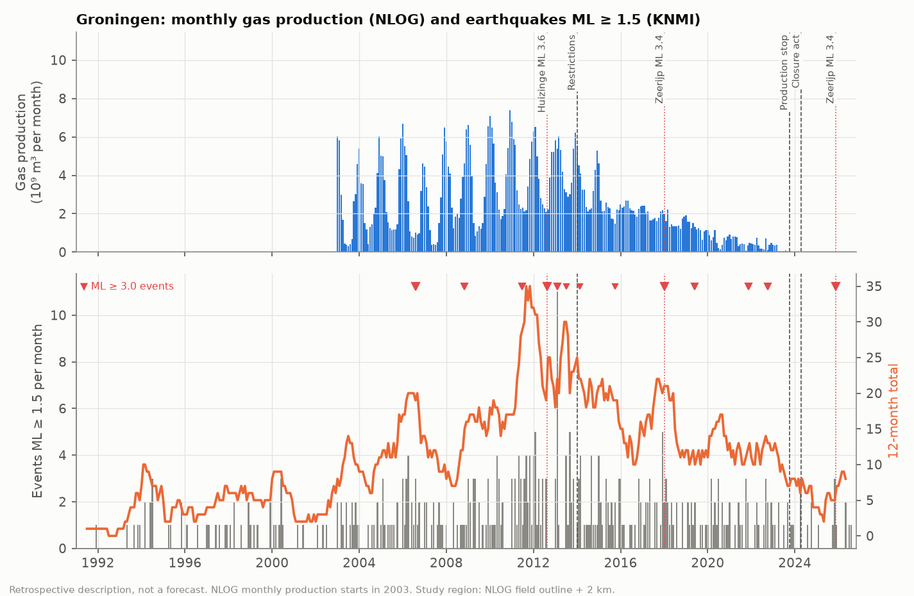
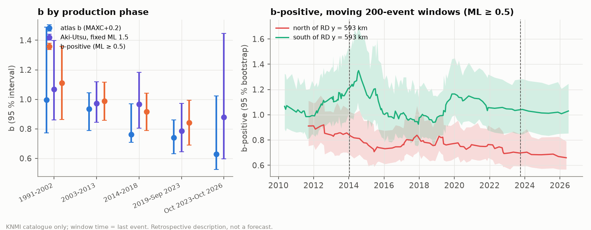
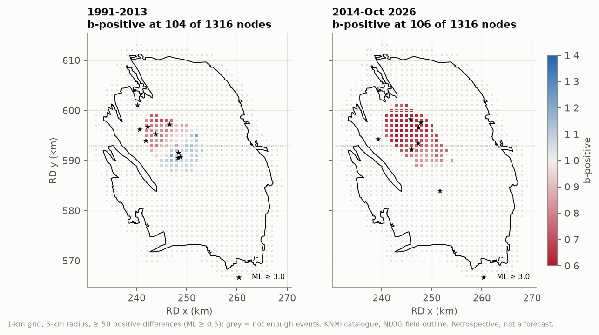
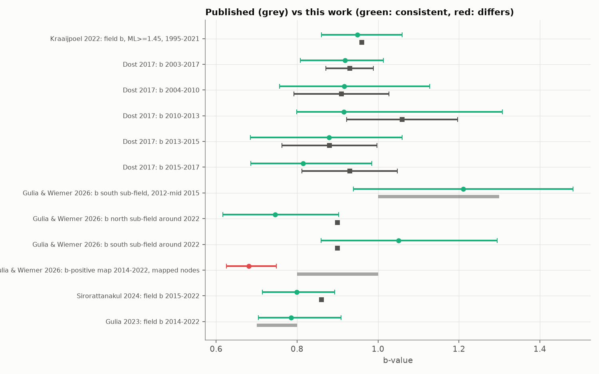

# Induced seismicity case study: Groningen gas field

This page covers the data, method, validation, limitations and data contract for the Groningen case study
(`site/data/induced/groningen/`). The code is in `scripts/induced/` and the tests are in `tests/test_induced.py`.

> **Retrospective description, not a forecast.** Everything here describes the published earthquake catalogue
> and production record up to the cut-off date. Nothing here is a forecast or a hazard assessment, and nothing
> predicts the rate or size of future earthquakes. Correlations are descriptive: they do not separate production
> from the other changes that happened at the same time, such as network upgrades and regional shifts in
> production.

## Contents

1. [Context](#context)
2. [Data](#data)
3. [Method](#method)
4. [Results](#results)
5. [Validation](#validation)
6. [Limitations and what was not verified](#limitations-and-what-was-not-verified)
7. [Gazli (Uzbekistan): context only](#gazli-uzbekistan-context-only)
8. [Data contract](#data-contract)
9. [Reproduce](#reproduce)
10. [References](#references)

## Context

Gulia & Wiemer (2026) summarise the history of the field:

> "The region was considered aseismic till 1991, when the first reported earthquake (Ml 2.3) occurred […] From
> 2003 onwards, driven by growing market demand, production levels rose, accompanied by an increase in both the
> frequency and magnitude of earthquakes. This culminated in a Ml 3.6 event in 2012, which produced significant
> non-structural damage, increased public concern and drove substantial regulatory intervention (Dost &
> Kraaijpoel, 2013). Starting from 2014, production measures aimed at lowering the level of seismicity have been
> implemented, and the production was gradually reduced by 80% in the central part of the field and instead
> moved towards the south. […] In 2019, the Dutch government announced an accelerated phase-out of extraction,
> with production ceasing entirely on 1 October 2023, and its permanent termination legislated in April 2024
> (Rijksoverheid, 2024)."

Dost et al. (2017) describe the restrictions as "Changes in production were made in early 2014, imposed by the
government."

The 16 August 2012 Huizinge event is in the KNMI catalogue as `knmi2012qcdh`, 2012-08-16T20:30:33 UTC, ML 3.6
(location name "Huizinge"). After 2012, the largest events are two ML 3.4 events near Zeerijp:
`knmi2018anwg` on 2018-01-08 (ML 3.43) and `knmi2025whfa` on 2025-11-14 (ML 3.44). Gulia & Wiemer (2026) also
mention the second one: "a Ml 3.4 event occurred on 14 November 2025 near Zeerijp".

The figures mark these milestones:

| Date | Milestone | Source |
|---|---|---|
| 2012-08-16 | Huizinge ML 3.6 | KNMI catalogue |
| early 2014 (drawn at 2014-01-01) | production restrictions begin | Dost et al. 2017; Gulia & Wiemer 2026 |
| 2018-01-08 | Zeerijp ML 3.4 | KNMI catalogue |
| 2023-10-01 | production stopped | Gulia & Wiemer 2026 |
| 2024-04-17 | "Wet van 17 april 2024" (closure act) | Staatsblad 2024, 114, as cited by Gulia & Wiemer 2026 |
| 2025-11-14 | Zeerijp ML 3.4 | KNMI catalogue |

The year-by-year production caps between 2014 and 2023 are not drawn. The only sources found for them were press
reports, which disagree with each other (for example on the 2015 cap). The production series itself shows the
effect of the caps.

## Data

### Sources and licences

| Input | Access | Licence (quoted) | Redistributed here |
|---|---|---|---|
| **KNMI earthquake catalogue**: origin time, epicentre, local magnitude, event type | FDSN event service `https://rdsa.knmi.nl/fdsnws/event/1/query`, `format=text`, yearly requests, box 52.90–53.70 N, 6.20–7.40 E, 1986-01-01 to 2026-11-01 | rdsa.knmi.nl: "Creative Commons Attribution 4.0 International (CC BY 4.0)" is the default, with the request of "citing the Royal Netherlands Meteorological Institute (KNMI) and including the DOI of the network(s)". Network DOI 10.21944/e970fd34-23b9-3411-b366-e4f72877d2c5 ("Netherlands Seismic and Acoustic Network", DataCite rights: CC BY 4.0). The portal also says the data "cannot be reused in unaltered form for commercial use". | Derived aggregates only: monthly counts, b-values and maps. For the 13 events of ML ≥ 3.0, `rates.json` keeps origin time, ML and the KNMI id (no locations), used by the plain-language summary; because the portal restricts unaltered commercial reuse of event rows, epicentres are not published. The event table itself is **not** published; scripts download it again. |
| **NLOG production figures**: Groningen field, gas, "Produced", monthly, 2003–2024 | `POST https://www.nlog.nl/nlog-mapviewer-api/rest/prodfigures/field`, the JSON service behind the NLOG datacenter ("Production and injection data are made available on the datacenter page") | NLOG disclaimer: "Users are permitted to copy, to download and to disclose in any way, to distribute or to simplify the information provided on this website […] Users are also permitted to copy, duplicate, process or edit the information and/or layout, provided NLOG.NL is quoted as the source." | Monthly and annual totals, attributed "Source: NLOG.NL" |
| **NLOG field outline**: `FIELD_CODE = 'GRO'` | ArcGIS REST `https://www.nlog.nl/standalone/rest/services/nlog_gdn/gdw_ng_field_utm_v1/MapServer/0`, `outSR=4326`, GeoJSON | same NLOG terms | The outline, rounded to 1e-4° |

Every raw response is cached once under `data/raw/induced/groningen/`, together with a `manifest.jsonl` that
records the URL, request body, byte size, SHA-256 and fetch time. `data/` is not committed.

### Magnitude type and completeness

The catalogue gives a local magnitude ML for every event. The `MagType` field is `MLn` or `MLnq`. Of the 1,919
rows in the box, 1,049 are MLnq (all before 2016) and 850 are MLn; 20 rows (controlled explosions) have no
magnitude. The analysis uses only rows with `EventType = "induced or triggered event"` (1,899 in the box).

Statements on completeness, quoted from Dost et al. (2017):

- "This network was designed to detect and locate earthquakes of magnitude 1.5 and larger."
- "Until 2014 Mc = 1.5 was adopted for the north of the Netherlands."
- "For Groningen, the location threshold decreased from ML ∼ 1.0–1.5 to ML ∼ 0.5."

Kraaijpoel et al. (2022) call ML 1.5 "a relatively safe (conservative upper bound) estimate of the completeness
level over the entire period and region".

Gulia & Wiemer (2026) use 1.5 "as Mc for the entire period, as this is the highest magnitude threshold for which
the seismic network was originally designed (Dost et al., 2017)".

**Event rates therefore use ML ≥ 1.5 for the whole period.** The b-values use the atlas's data-driven Mc as well
(see Method).

### Production

NLOG: "Production figures are available since January 1st , 2003. Data prior to this date is not released to the
public domain". No production curve is drawn before 2003.

The service returns volumes in units of 10³ m³. The datacenter client sets the default unit to `Sm3`. Two
cross-checks against NLOG's own 2015 annual table:

- 2015: our sum of the 12 monthly values is 28,102.9 × 10⁶ m³. The table says "Groningen field 28.103"
  (10⁶ Nm³). This matches.
- 2014: the table gives "-14.054" as the change from 2014, which implies 42,157 × 10⁶ m³. Our 2014 sum is
  42,409 × 10⁶ m³, 0.6 % higher. The reason is not known; later revisions of the figures are one possibility.

Peak and end of the series: 54.2 × 10⁹ m³ in 2013, 1.46 × 10⁹ m³ in 2023 and 0.008 × 10⁹ m³ in 2024. NLOG has no
values after 2024-12.

### Study region

The **study region** is the NLOG Groningen field outline buffered by 2 km (968.6 km² unbuffered). It holds 1,646
induced events. The 2 km buffer was chosen because it reproduces the event counts of Dost et al. (2017) Table 1
(all magnitudes):

| Interval | Our count | Published count |
|---|---|---|
| 2004–2010 | 200 | 204 |
| 2010–2013 | 211 | 210 |
| 2013–2015 | 200 | 199 |
| 2015–2017 | 228 | 227 |
| 2003–2017 | 883 | 887 |

With no buffer, the region holds 1,571 events and the counts are 3–9 % lower. The Kraaijpoel et al. (2022) test
uses the unbuffered outline, which is what that paper used.

## Method

All estimators are imported from the atlas (`scripts/seislib.py` and `scripts/atlaslib.py`). Magnitudes are
binned to 0.1 for every estimate.

- **Event rate:** the number of events with ML ≥ 1.5 per calendar month. Phase rates come with exact Poisson 95 %
  intervals.
- **Rate vs production:** the Spearman rank correlation of annual counts against annual production, 2003–2024 (22
  years), computed at zero lag and at a one-year lag (production in year *y* against events in year *y + 1*). The
  annual values are autocorrelated, so the p-values are only indicative.
- **b by phase.** Three estimators are used on the region's events in each phase:
  1. the atlas estimator `atlaslib.cell_b`: Mc = MAXC + 0.2, a 95 % bootstrap interval in which Mc is
     re-estimated in every replicate, and the A/B/C/insufficient quality gate (a b-value needs at least 50 events);
  2. maximum likelihood for binned magnitudes at a fixed ML 1.5 with a percentile bootstrap (`inducedlib.b_fixed`);
  3. b-positive (`atlaslib.cell_bpos`; van der Elst 2021) on events with ML ≥ 0.5, with magnitude differences
     ≥ 0.2 and at least 50 differences.
- **b in time:** b-positive in moving windows of 200 events (step 5) for the north and south sub-fields, which are
  split at RD y = 593,000 m as in Gulia (2023) and Gulia & Wiemer (2026). The window time is the time of the last
  event, and the interval is a 95 % bootstrap over the window's differences.
- **b in space:** a 1-km grid in RD New (EPSG:28992), keeping the nodes inside the study region. Each node uses
  the events within 5 km, the same grid and radius as Gulia (2023) and Gulia & Wiemer (2026). At every node the
  map stores both b-positive (≥ 50 differences, as in Gulia & Wiemer 2026) and the atlas `cell_b`. The per-event
  floor for `cell_b` is the field-wide MAXC + 0.2 of the period. Periods: 1991–2013, 2014–Oct 2026, and 2014–2022
  (used for validation).
- **Random seed:** 20261114. Every published interval uses 1,000 bootstrap replicates (`atlaslib.NBOOT`): phase b,
  validation, maps and moving windows (maps and moving windows used 200 before 0.6.0).

## Results



**Rate vs production.** Events with ML ≥ 1.5 in the study region, by phase:

| Phase | Events | Rate per year (95 %) | Mean production (10⁹ m³/yr) |
|---|---|---|---|
| 1991–2002 | 47 | 3.9 (2.9–5.2) | no public monthly data |
| 2003–2013 | 182 | 16.5 (14.2–19.1) | 39.7 |
| 2014–2018 | 86 | 17.2 (13.8–21.2) | 28.1 |
| 2019–Sep 2023 | 58 | 12.2 (9.3–15.8) | 7.6 |
| Oct 2023–Oct 2026 (after shut-in) | 18 | 5.8 (3.5–9.2) | 0 |

In plain terms:

- **2003–2018:** about 1.4 events of ML ≥ 1.5 per month.
- **After shut-in:** about 1 such event every two months.
- **The first five years of restrictions (2014–2018):** the field-wide rate did not fall below its 2003–2013
  level, although production fell by about 30 %.
- **Correlation of annual counts with annual production (2003–2024):**
  - same year: Spearman ρ = 0.51 (p = 0.015);
  - production one year earlier: ρ = 0.74 (p = 8.2 × 10⁻⁵).

Since 2012, three events reached ML 3.4 or more: Huizinge 3.6 in 2012, and Zeerijp 3.43 in 2018 and 3.44 in
2025. The last of these occurred after production had stopped.



**b by phase.** Each value is b (95 % interval) followed by n, the number of events (or magnitude differences)
that the b-value is computed from.

| Phase | Atlas MAXC+0.2: Mc | Atlas MAXC+0.2: b | Fixed ML 1.5 | b-positive (ML ≥ 0.5) |
|---|---|---|---|---|
| 1991–2002 | 1.3 | 1.02 (0.78–1.44), n 72, quality C | 1.09 (0.86–1.42), n 47, insufficient | 1.12 (0.87–1.37), n 54 |
| 2003–2013 | 1.4 | 0.94 (0.79–1.04), n 218, A | 0.98 (0.85–1.13), n 182 | 0.99 (0.86–1.12), n 229 |
| 2014–2018 | 0.7 | 0.76 (0.71–0.97), n 351, B | 0.97 (0.80–1.22), n 86 | 0.92 (0.79–1.05), n 184 |
| 2019–Sep 2023 | 0.8 | 0.74 (0.64–0.87), n 188, B | 0.79 (0.65–0.98), n 58 | 0.84 (0.69–1.00), n 112 |
| after shut-in | 0.6 | 0.63 (0.52–1.03), n 64, C | 0.88 (0.58–1.49), n 18, insufficient | not enough differences (31) |

All three estimators fall from about 1.0 before 2014 to about 0.75–0.85 in 2019–2023. After 2014 the atlas
estimator (Mc 0.7–0.8) gives lower values than the estimator with a fixed ML 1.5. This Mc dependence is listed
under Limitations.

The moving b-positive series show the north lower than the south throughout:

| Sub-field | 2012 to mid-2015 (window range) | Window ending closest to mid-2022 |
|---|---|---|
| North | 0.71–0.93 | 0.75 (0.62–0.91) |
| South | 1.00–1.36 | 1.06 (0.86–1.31) |



**b in space.** In 1991–2013, b-positive could be mapped at 104 of the 1,316 grid nodes. The map is low (about
0.7) in the north-west of the central area, around Loppersum and Huizinge, and higher (about 1.1–1.2) south of
RD y = 593 km. In 2014–Oct 2026 the mapped area (106 nodes) is uniformly low. Gulia & Wiemer (2026) describe a
similar development: "the whole field converges to a single, low and uniform value". Only the densest part of the
field can be mapped from the KNMI catalogue alone (see Validation).

## Validation

Each row compares our value with a published value. The "Ours" column gives b (95 % interval) and, after a
semicolon, n, the number of events (or magnitude differences) used.

| Source | Quantity | Published | Ours | Verdict |
|---|---|---|---|---|
| Kraaijpoel et al. 2022 | events with unrounded ML ≥ 1.45, 1995–2021, field outline | 336 | 332 | **matches** (−1.2 %; the NLOG outline is used here, the paper used the NAM 2021 outline) |
| Kraaijpoel et al. 2022 | field b, same sample ("MLE for the constant b-value is 0.96") | 0.96 | 0.952 (0.858–1.062); unbinned MLE 0.956 | **consistent** |
| Dost et al. 2017 | b 2003–2017 | 0.93 ± 0.03 | 0.922 (0.811–1.014), Mc 1.4; n 281 | **consistent** |
| Dost et al. 2017 | b 2004–2010 | 0.91 ± 0.06 | 0.920 (0.756–1.125), Mc 1.4; n 89 | **consistent** |
| Dost et al. 2017 | b 2010–2013 | 1.06 ± 0.07 | 0.919 (0.803–1.387), Mc 1.1; n 127 | **consistent** |
| Dost et al. 2017 | b 2013–2015 | 0.88 ± 0.06 | 0.883 (0.666–1.071), Mc 1.1; n 121 | **consistent** |
| Dost et al. 2017 | b 2015–2017 | 0.93 ± 0.06 | 0.818 (0.696–0.957), Mc 0.8; n 115 | **consistent** |
| Dost et al. 2017 | b 1996–2003 | 1.06 ± 0.07 | 1.17, Mc 1.8; n 13 | **not testable** (fewer than 50 events above the atlas Mc) |
| Gulia & Wiemer 2026 | south sub-field, 2012 to mid-2015 ("ranging between 1.0 and 1.3") | 1.0–1.3 | 1.22 (0.94–1.49); n 91 | **consistent** |
| Gulia & Wiemer 2026 | north sub-field, 2012 to mid-2015 ("minor b-value fluctuations around 0.8") | ≈ 0.8 | pooled: 39 differences, below 50; moving windows 0.71–0.93 | **not testable** (KNMI data alone are too sparse) |
| Gulia & Wiemer 2026 | north around 2022 ("converge towards comparable values (0.9 around 2022)") | ≈ 0.9 | 0.747 (0.621–0.906), window 2015.8–2022.5 | **consistent** (interval only; see note) |
| Gulia & Wiemer 2026 | south around 2022 | ≈ 0.9 | 1.056 (0.856–1.309), window 2017.4–2022.3 | **consistent** (interval only; see note) |
| Gulia & Wiemer 2026 | b-positive map 2014–2022 ("values typically in the range 0.8–1.0") | 0.8–1.0 | median 0.682, inter-quartile range 0.626–0.750, over 75 mapped nodes | **differs** |
| Gulia 2023, as quoted by Gulia & Wiemer 2026 | field after 2014 ("around ~0.7–0.8") | 0.7–0.8 | 0.788 (0.711–0.917), Mc 0.8; n 482 | **consistent** |
| Sirorattanakul et al. 2024, as quoted by Gulia & Wiemer 2026 | field 2015–2022 ("b ≈ 0.86") | 0.86 | 0.801 (0.719–0.891), Mc 0.8; b-positive 0.881 (0.777–0.986) | **consistent** (different catalogue: context only) |



**Verdict rules:**

- A published value with ± σ is **consistent** when |ours − published| ≤ 1.96 √(σ² + σ_ours²), where
  σ_ours = (95 % interval width) / 3.92.
- A published range or approximate value is **consistent** when our 95 % interval overlaps it.
- A count **matches** when it is within 3 %.

**What the table shows:**

- **Classic field-wide numbers are reproduced.** These are the Kraaijpoel 2022 count and b, and the four Dost 2017
  intervals with more than 50 events. All agree within their uncertainties.
- **Dost et al. (2017) do not state the Mc behind their Table 1.** Our values at a fixed Mc of 1.0, 1.2 and 1.5 are
  in `validation.json`. At Mc 1.2 they come closest to the paper:

  | Interval | Ours at Mc 1.2 | Dost et al. 2017 |
  |---|---|---|
  | 2004–2010 | 0.917 | 0.91 |
  | 2010–2013 | 0.991 | 1.06 |
  | 2013–2015 | 0.895 | 0.88 |
  | 2015–2017 | 0.923 | 0.93 |
  | 2003–2017 | 0.912 | 0.93 |

  This is a sensitivity check, not a fit. The result is reported with the atlas MAXC + 0.2 estimator.
- **Gulia & Wiemer (2026) used a composite catalogue:** KNMI before 2015 and the deep-learning catalogue of
  Sirorattanakul et al. (2024) for 2015–2022, which they describe as "almost double the number of events recorded
  in the standard KNMI catalogue". Our KNMI-only analysis therefore cannot test every claim:
  - **North vs south.** We reproduce lower north than south b before 2015. Around 2022 our point estimates are
    0.75 (north) and 1.06 (south). That is not convergence, even though both intervals include 0.9.
  - **The map comparison differs.** With a 5-km radius and only KNMI events, just 75 of 1,316 nodes reach
    50 differences, and these are the densest, lowest-b nodes of the central field. A wider radius maps more of
    the field and moves the median into the published range:

    | Radius | Mapped nodes | Median b-positive |
    |---|---|---|
    | 5 km | 75 | 0.682 |
    | 7 km | 300 | 0.785 |
    | 10 km | 645 | 0.813 |

    Most likely the difference comes from coverage and selection, not from a different estimator. This is not
    proven.

## Limitations and what was not verified

- **Catalogue.**
  - KNMI only. The deep-learning catalogue of Sirorattanakul et al. (2024) was not used.
  - The KNMI event list was downloaded on 2026-11-14. KNMI can revise magnitudes and locations.
- **Mc dependence after 2014.** Over 2014–2018, b changes with the completeness level chosen:

  | Estimator | b, 2014–2018 |
  |---|---|
  | atlas MAXC + 0.2 (Mc 0.7) | 0.76 |
  | b-positive (ML ≥ 0.5) | 0.92 |
  | fixed ML 1.5 | 0.97 |

  The b drop after 2014 is therefore partly sensitive to how incompleteness is handled below ML 1.0. Over
  2019–Sep 2023 all three estimators agree within their intervals.
- **Production** is field-total only. Cluster-level production, which the restrictions targeted, was not used.
  Monthly data start in 2003, and production before 2003 is not shown.
- **Not drawn:**
  - the year-by-year production caps (no primary source was retrieved);
  - pressure, compaction and stress models (Bourne et al. 2014; Bourne & Oates 2020). These are the physical link
    between production and seismicity. This study does not model them.
- **Not checked against this data:**
  - The forecast of Dempsey & Suckale (2017) for February 2017 to 2024 has not been compared with the observed
    events. That comparison would be a forecast evaluation, which is outside the scope of this page.
  - Spetzler & Dost (2017) zone b-values (0.9, 0.9 and 1.1), quoted in Gulia & Wiemer (2026), were not tested:
    the zone polygons were not retrieved.
- **The correlations** describe co-variation of yearly totals. They do not establish cause and are not a
  forecasting model.

## Gazli (Uzbekistan): context only

No open monthly or annual production series for the Gazli gas field was found, so no Groningen-style analysis is
possible. A separate exploratory analysis of the open EMCA catalogue (Mikhailova et al. 2015), which is not part
of this repository, counted events within 100 km of the three M ~ 7 shocks (1976 Mw 6.6 and 6.7, 1984 Mw 7.0):

| Period | Events at MLH ≥ 4 |
|---|---|
| 1950–1975 | none (EMCA lists 5 events, all MLH 3.5–3.9) |
| 1976–1990 | 9.6 per year |
| 1990–2010 | 0.65 per year |

Whether the sequence was induced by gas extraction is debated in the literature. Those counts are context only,
and this atlas makes no new claim about Gazli.

## Data contract

Directory: `site/data/induced/groningen/`. These rules apply to every file:

- JSON with `null` for missing values.
- Coordinates in WGS84 degrees.
- Magnitudes are KNMI ML.
- Times are UTC.
- A b-value is never given without its 95 % interval (`lo`, `hi`), and the site must not draw one without them.

`contract_version` is in `index.json`. New keys may be added; existing keys are not renamed or re-scaled without a
version bump.

| File | Size | Content |
|---|---|---|
| `index.json` | ~1.5 kB | `id`, `title`, `contract_version`, `catalogue_cutoff_utc`, `region`, `magnitude`, `n_events_region`, `statement` (the "not a forecast" sentence, which must be shown with any view of this data), `files` (name → bytes), `sources[]` (`name`, `licence`, `attribution`, `redistributed`). The site must show every `attribution`. |
| `rates.json` | ~11 kB | See "`rates.json` fields" below. |
| `btime.json` | ~20 kB | See "`btime.json` fields" below. |
| `bmap.json` | ~60 kB | See "`bmap.json` fields" below. |
| `validation.json` | ~7 kB | See "`validation.json` fields" below. |

### `rates.json` fields

| Key | Content |
|---|---|
| `monthly` | Columnar: `month` (`YYYY-MM`, 1991-01 to 2026-10), `n_ge15` (events with ML ≥ 1.5), `prod_bcm` (10⁹ m³; `null` before 2003 and after 2024). |
| `annual` | Columnar: `year`, `n_ge15`, `prod_bcm` (`null` unless all 12 months are present), `months` (months covered; 10 for 2026). |
| `phases[]` | `label`, `start`, `end` (end is exclusive), `years`, `n_ge15`, `rate_per_yr`, `rate_lo`, `rate_hi` (Poisson 95 %), `prod_bcm_per_yr`. |
| `correlation` | `spearman_rho`, `p`, `lag1_rho`, `lag1_p`, `years`, `n_years`. |
| `milestones[]` | `date`, `label`, `short`, `kind` (`event` or `policy`). |
| `events_ge3` | Columnar: `time`, `ml`, `id` (the KNMI event id), for the 13 events of ML ≥ 3.0. No locations (see the licence row above). |
| `mc` | 1.5 |

### `btime.json` fields

| Key | Content |
|---|---|
| `phases[]` | `label`, `start`, `end`, `n_all`, and three blocks: `atlas` (`b`, `lo`, `hi`, `mc`, `n`, `q`), `mc15` (`b`, `lo`, `hi`, `n`, `q`) and `bpos` (`b`, `lo`, `hi`, `n`). A `q` of `C` or `insufficient` means the value should be shown greyed or not at all. |
| `moving.{field,north,south}` | Columnar: `t0`, `t` (decimal years of the first and last event of the window), `b`, `lo`, `hi`, `n_diff`. |
| other keys | `window`, `bpos_floor`, `ns_split_rd_y` |

### `bmap.json` fields

| Key | Content |
|---|---|
| top level | `spacing_m` (1000), `radius_m` (5000), `outline` (GeoJSON Polygon geometry of the NLOG field outline; rings 2 and 3 are holes), `periods` |
| `periods` keys | `"1991-2013"`, `"2014-Oct 2026"`, `"2014-2022"` |
| each period | `floor_mc`, `n_events`, `n_nodes_grid`, and columnar node arrays for nodes where at least one estimate exists: `lon`, `lat`, `n` (events within the radius), `bpos`, `bpos_lo`, `bpos_hi`, `n_bpos`, `b`, `b_lo`, `b_hi`, `q` (atlas quality), `mc`. Nodes on the 1-km grid that are missing from the arrays had too few events. |

### `validation.json` fields

| Key | Content |
|---|---|
| `rows[]` | `id`, `source`, `quantity`, `published` (number or `[lo, hi]` range), optional `published_sigma`, `ours`, `ours_lo`, `ours_hi`, `n`, `verdict` (`consistent`, `differs`, `matches` or `not testable`), `note`, plus row-specific extras: `b_at_fixed_mc`, `ours_unbinned`, `ours_moving_range`, `window_years`, `radius_sensitivity`, `ours_bpos`, `ours_bpos_ci`. |

**Licence obligations for the site:**

- Show the KNMI attribution with the network DOI.
- Show "Source: NLOG.NL" next to any production curve or the outline.
- Do not offer a download of single KNMI events. `rates.json` keeps only time, ML and id of the 13 events of
  ML ≥ 3.0, without locations; the portal's "cannot be reused in unaltered form for commercial use" clause applies
  to these rows.

## Reproduce

```sh
.venv/bin/python -I scripts/induced/fetch_groningen.py      # downloads (cached) into data/raw/induced/groningen
.venv/bin/python -I scripts/induced/build_groningen.py      # JSON + figures
.venv/bin/python -I -m pytest -q tests/test_induced.py
```

## References

- Bourne, S.J., Oates, S.J., van Elk, J. & Doornhof, D. (2014). A seismological model for earthquakes induced by
  fluid extraction from a subsurface reservoir. *JGR Solid Earth* 119, 8991–9015. doi:10.1002/2014JB011663
- Bourne, S.J. & Oates, S.J. (2020). Stress-dependent magnitudes of induced earthquakes in the Groningen gas field.
  *JGR Solid Earth*. doi:10.1029/2020JB020013
- Dempsey, D. & Suckale, J. (2017). Physics-based forecasting of induced seismicity at Groningen gas field, the
  Netherlands. *GRL*. doi:10.1002/2017GL073878
- Dost, B. & Kraaijpoel, D. (2013). The August 16, 2012 earthquake near Huizinge (Groningen). KNMI report.
- Dost, B., Ruigrok, E. & Spetzler, J. (2017). Development of seismicity and probabilistic hazard assessment for
  the Groningen gas field. *Netherlands Journal of Geosciences* 96(5), s235–s245. doi:10.1017/njg.2017.20
  (CC BY 4.0)
- Gulia, L. (2023). Time–space evolution of the Groningen gas field in terms of b-value: insights and implications
  for seismic hazard. *SRL* 94(4), 1807–1820. doi:10.1785/0220220396
- Gulia, L. & Wiemer, S. (2026). Confirming b-value spatial variations in Groningen gas field using
  machine-learning-derived seismic data. *Netherlands Journal of Geosciences* 105, e13892.
  doi:10.70712/NJG.v105.13892 (CC BY 4.0)
- KNMI (1993). Netherlands Seismic and Acoustic Network. Royal Netherlands Meteorological Institute.
  doi:10.21944/e970fd34-23b9-3411-b366-e4f72877d2c5
- Kraaijpoel, D., Martins, J.E., Osinga, S., Vogelaar, B. & Breunese, J. (2022). Statistical analysis of static and
  dynamic predictors for seismic b-value variations in the Groningen gas field. *Netherlands Journal of
  Geosciences* 101, e18. doi:10.1017/njg.2022.15 (CC BY 4.0)
- Mikhailova, N.N. et al. (2015). EMCA earthquake catalogue. *Annals of Geophysics* 58(1), S0102; data
  doi:10.5880/GFZ.EWS.2015.001
- NLOG.NL: production figures, field outlines and disclaimer, https://www.nlog.nl (accessed 2026-11-14).
- Sirorattanakul, K. et al. (2024, online). Bursts of fast propagating swarms of induced earthquakes at the
  Groningen gas field. *SRL* 96(1), 130–146. doi:10.1785/0220240107
- van der Elst, N.J. (2021). B-positive: a robust estimator of aftershock magnitude distribution in transiently
  incomplete catalogs. *JGR Solid Earth* 126. doi:10.1029/2020JB021027
