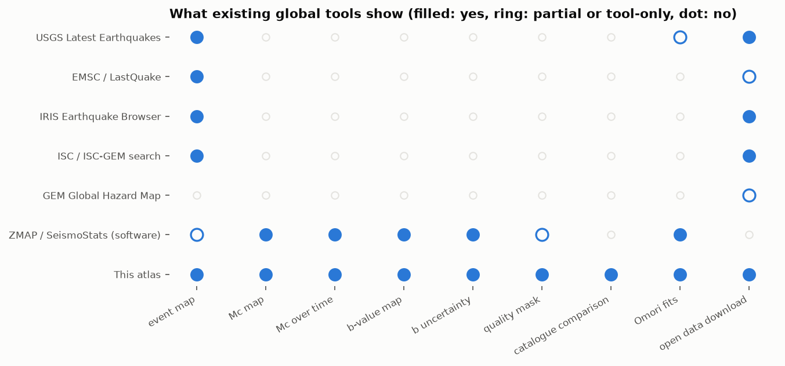

# Prior work

Research date: 2026-11-13. The question was whether an open global map of completeness (Mc) and Gutenberg-Richter
b-values **with uncertainties** already exists. We found none. The pieces exist separately: methods, global
summary numbers, and regional maps.

The matrix is our reading of each tool's public interface and documentation on the research date. It is not an
audit: "no" means we did not find the feature.

## Existing global viewers and what they do not show

| Tool | What it shows | What it does not show |
|---|---|---|
| USGS Latest Earthquakes / ComCat search | events, filters, CSV/GeoJSON download; aftershock forecasts (Reasenberg-Jones/ETAS) on some event pages | completeness, b-values, catalogue quality, which magnitude type is behind "M4.5+" |
| EMSC / LastQuake | real-time events, felt reports | catalogue statistics |
| IRIS Earthquake Browser (IEB) | up to 25,000 epicentres per view, region selection, 3D, download ([IEB help](https://ds.iris.edu/ieb/help)) | Mc, b, uncertainty |
| ISC Bulletin / ISC-GEM pages | event search; ISC-GEM download with completeness discussed in papers | an interactive Mc or b map |
| GEM Global Seismic Hazard Map | modelled ground-shaking hazard (CC BY-NC-SA; we only link to it) | the catalogue statistics behind it, per place |
| ZMAP, SeismoStats (software) | Mc and b maps for a catalogue the user supplies | a published, maintained global map |

## Methods we build on

- **Spatial b and Mc mapping.** Wiemer & Wyss (2000, BSSA) introduced the goodness-of-fit Mc. Wiemer & Wyss
  (2002, Adv. Geophys. 45) describe constant-radius and nearest-N mapping, the two standard approaches. Local b
  varies roughly 0.4–2.0 between studies ([Godano et al. 2022 review](https://pubblicazioni.unicam.it/retrieve/572cb817-66f7-4fdc-92b9-b608ca6970cf/2022.GodanoetlESS.pdf),
  [NHESS 2023](https://nhess.copernicus.org/articles/23/91/2023/)).
- **Mc estimators and their bias.** Woessner & Wiemer (2005, BSSA): MAXC + 0.2 correction, bootstrap of Mc and b.
  Mignan & Woessner (2012, CORSSA, doi:10.5078/corssa-00180805): review; MAXC and GFT tend to underestimate Mc,
  MBS to overestimate it.
- **b-positive.** van der Elst (2021, JGR 126, e2020JB021027,
  [USGS](https://www.usgs.gov/publications/b-positive-robust-estimator-aftershock-magnitude-distribution-transiently-incomplete)):
  uses positive successive magnitude differences and is robust to transient incompleteness. Follow-up work on
  b-more-positive: [arXiv 2504.04663](https://arxiv.org/html/2504.04663v1).
- **b-value pitfalls.** Marzocchi, Spassiani, Stallone & Taroni (2020, GJI 220, 1845,
  [earth-prints](https://www.earth-prints.org/handle/2122/13344)): finite samples bias b and its uncertainty, and
  b correlates with the largest magnitude in the sample. Marzocchi & Sandri (2003): treating magnitudes as
  continuous biases b. Sandri & Marzocchi (2007): least squares should not be used.

## Global b and completeness studies

- **Michael (2014), BSSA 104(4), 1829–1837**, "How complete is the ISC-GEM Global Earthquake Catalog?"
  ([USGS pubs](https://pubs.usgs.gov/publication/70137462)).
  - Shallow (< 60 km) Mc: 7.7 (1900–1917), 7.0 (1918–39), 6.8 (1940–54), 6.5 (1955–63), 6.0 (1964–75),
    5.8 (1976–2003), 5.7 (2004–09). The shallow data fit b = 1.05, a = 8.3.
  - Deep events: Mc 7.1 (1900–63) and 5.7 (1964–2009), with **b = 0.99, a = 7.3 for 1964–2009**.
  - *Correction to the project brief:* "b ≈ 0.99, a ≈ 7.3" is Michael's value for **deep** events; the shallow
    value is 1.05.
- **ISC-GEM completeness.**
  - Di Giacomo et al. (2015) report the catalogue complete down to Mw 5.6 from 1964, and 7.5 to 6.2 in the early
    instrumental period.
  - Di Giacomo, Engdahl & Storchak (2018, [ESSD 10, 1877](https://essd.copernicus.org/articles/10/1877/2018/))
    give the selection thresholds of v1: 7.5 before 1918, 6.25 for 1918–1959, 5.5 from 1960. They warn that
    these thresholds are not completeness levels.
  - *Correction to the brief:* "Mw 5.6 before 1964 and 6.4 after" is reversed. Completeness is about 5.6 *from*
    1964 and higher before.
- **Kagan; Bird & Kagan (2004, BSSA 94(6)).** The moment-distribution exponent β is near-universal, 0.63–0.67
  (b = 1.5 β ≈ 0.95–1.0), for subduction and continental boundaries.
  - Mid-ocean earthquakes give β 0.8–1.1 (Kagan 2002, quoted in [Kagan 2010, arXiv 0908.1207](https://www.arxiv.org/abs/0908.1207v2)).
    Kagan attributes this to mixing populations with different corner magnitudes.
  - Bird & Kagan give corner magnitudes per class (for example SUB 9.58, CCB 8.46, CRB 7.64). We could not
    retrieve their β table.
- **Nishikawa & Ide (2014, Nat. Geosci. 7, 904, doi:10.1038/ngeo2279).** b of 88 subduction-zone sections (ANSS
  catalogue) increases with slab age and does not correlate with plate speed
  ([U. Tokyo](https://www.u-tokyo.ac.jp/focus/en/articles/a_00329.html)).
- **Faulting style.** Schorlemmer, Wiemer & Wyss (2005, Nature): b is highest for normal faulting, intermediate for
  strike-slip and lowest for thrust. Petruccelli et al. (2019, EPSL and
  [GRL](https://www.earth-prints.org/bitstream/2122/12756/1/Petruccelli_et_al_GRL_2019.pdf)) confirm this with
  the rake.
- **TRACE (2026, [arXiv 2603.21152](https://arxiv.org/abs/2603.21152v1)).** A multi-agent LLM system for
  seismology.
  - Its main text contains local b-values only.
  - Global plate-boundary b-values attributed to it in the project brief and in a search summary (spreading
    ≈ 1.12, extension ≈ 0.93, others lower; Mc ≈ 5.3–5.4) could not be found in the v4 text. We treat them as
    unverified (see [validation](validation.md) §4 and [AI in seismology](ai-in-seismology.md)).

## Catalogue homogenisation

- **ISC-GEM** recomputed Ms and mb and derived exponential mb/Ms → Mw relations. It prefers direct GCMT Mw for
  1976–2009 (Di Giacomo et al. 2015).
  - A 2023 GJI paper ([cris.unibo.it](https://cris.unibo.it/retrieve/8c801cf3-2505-4a49-90eb-c8e2df7c1e6c/ggad164.pdf))
    notes that these relations are biased at low magnitude by Mw incompleteness and by ordinary least squares.
- **Scordilis (2006, J. Seismol. 10, 225).** Global relations. The slope for mb ≤ 6.2 is 0.85 ± 0.04 (39,784
  events); the Ms slopes are 0.67 and 0.99 (as quoted in [arXiv 2410.09813](https://arxiv.org/pdf/2410.09813)).
  - We use these slopes and fit only the intercepts (method §2). Our data show that converting mb inflates b by
    0.25–0.36 below Mw 5.4 (validation §5).

## Gap this atlas fills

No open source provides a global, per-place Mc and b with stated uncertainty, quality masks, both catalogues
compared, and downloadable data. Regional maps exist (e.g. Southern California, Japan, Central Asia). ZMAP-style
tools let a specialist compute one. The global numbers above are single values per class or per period. The atlas
publishes the per-place version, shows where it cannot be computed, and gives the reason.
