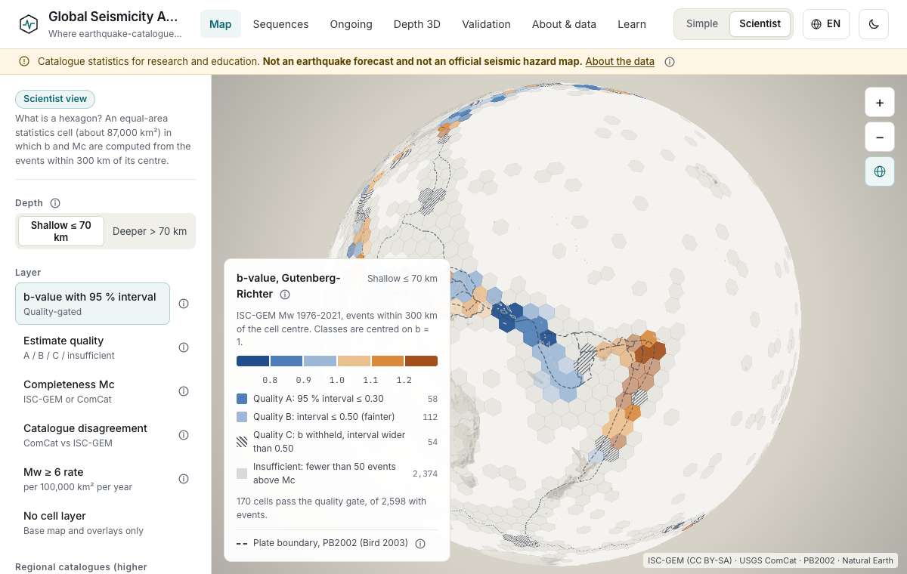
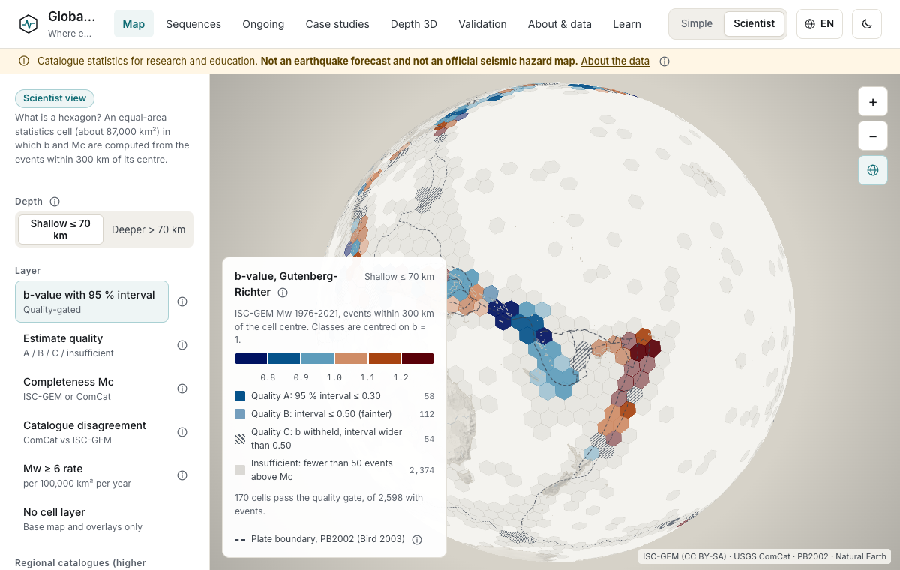

# UX notes for the website

Reference products looked at on 2026-11-13 (USGS Latest Earthquakes, IRIS/EarthScope Interactive Earthquake
Browser, GEM OpenQuake map viewer; EMSC from earlier use). What we take, and what we avoid:

- **Map first, controls beside it (USGS, IEB).** The map is the page. Controls sit in one panel at the side, not
  scattered over the map. We keep one left panel that holds layer choice, depth, overlays and the legend.
- **The legend belongs to the layer (GEM).** GEM's legend names the quantity and its unit ("PGA (g)") with
  explicit class ranges. Ours does the same for every layer, and changes with it, including the meaning of grey
  and hatched cells.
- **Stepped classes, not a smooth rainbow (GEM, IEB).** Readers can match a colour to a range. We use 5–6
  stepped classes, one hue for magnitudes and two hues around b = 1 for the b-value, never a rainbow (IEB's
  depth rainbow is hard to read for colour-blind users).
- **List and map tell the same story (USGS).** The USGS list links to event pages by id. Our events link to the
  USGS event page by ComCat id, and the sequence list has a "Show on map" action.
- **Say what is missing (IEB "1000 of 4,275,908 visible").** We always show how many events are visible and why
  a cell has no b-value (quality C or too few events), instead of leaving it blank.
- **Avoid clutter.** No third-party basemap with place names, no ads, no social widgets, no watermark
  (GEM), no stacked accordions of boilerplate. Place names are not needed for catalogue statistics.
- **Disclaimer visible but quiet (GEM).** GEM hides its disclaimer in an accordion. Ours is a one-line strip on
  the map that is always visible, with the full text on the About page.
- **Details on demand.** Hover gives a short summary; a click opens a panel (a bottom sheet on phones) that
  loads the per-cell charts only then.
- **Shareable state.** IEB keeps its state in the URL. We keep layer, depth, overlays, selected cell, page and
  map position in the URL hash.

## Design decisions

- **Design reference.** The look and structure follow the design mock-ups made for this project (desktop map with a
  selected cell, 390 × 844 bottom sheet, validation page): header with a version and cut-off label, a persistent
  disclaimer strip, a left control rail, a legend card on the map, and a right cell panel with b in large mono
  type, an interval-on-scale bar, a 2 × 2 tile grid, a cumulative FMD with a dashed Mc line and a catalogue
  agreement list. On phones: a chip row for layers and a bottom sheet with a "Full details and charts" button.
- **Tokens.** Inter for the interface and IBM Plex Mono for every number (both vendored, SIL OFL). Warm neutral
  base (page `#F7F6F2`, ocean `#F4F3EF`, land `#E4E1D9`), one UI accent (`#0E6B73`) that never encodes data, and a
  dark theme derived from the same roles. b classes use the six-step blue to orange-brown palette centred on
  b = 1; quality B is the same colour at about 55 % opacity, C is hatched, insufficient is a light grey wash.
- **Charts** follow the `dataviz` method: 2 px lines, markers with a surface ring, hairline grid, a legend for two
  or more series, a crosshair or per-mark tooltip that also works with the arrow keys, and a data table under every
  chart. The categorical chart colours were run through the dataviz validator (all-pairs, both modes): pass; the
  aqua slot is below 3:1 on white, so the data tables are the required relief.

## ui-ux-pro-max

- `--design-system` for "scientific data atlas map research" returned **Minimalism & Swiss Style** (kept: clean,
  grid-based, functional). Its palette (red primary `#FF4D4D`) and fonts (Exo + Roboto Mono) were **not used**: a
  red primary reads as alarm on a map that must not look like a hazard map, and the project's design reference
  sets Inter + IBM Plex Mono.
- Chart guidance for geographic data: "pair fills with boundaries or patterns; location meaning cannot depend on
  colour alone; a11y fallback: a region table". Applied: hatch for C cells, values in the tooltip, and a
  **sortable table of every cell with a b-value** (link under the layer list) that opens each cell.
- Pre-delivery checklist outcome:
  - No emoji icons; all icons are inline SVG with one stroke weight. Pass.
  - Touch targets ≥ 44 px on phones (layer chips, map buttons, close and menu buttons, list rows). Pass.
  - Contrast (computed, WCAG 2): body and muted text ≥ 5.6:1, accent on white 6.2:1, disclaimer 8.8:1, verdict
    pills ≥ 7.1:1 in light and ≥ 8.0:1 in dark. Pass.
  - Visible focus ring on every control; keyboard reaches depth, layers, overlays and theme (tested). Pass.
  - `prefers-reduced-motion` disables animations. Not tested in a browser.
  - Responsive: tested at 1440 × 900 and 390 × 844, no horizontal scroll on any page (tested). Landscape and
    Dynamic Type were not tested.

## Additions on 2026-11-13

- **Compare two cells.** "Compare with another cell" in the cell panel pins the cell as A (`k=` in the URL, a banner
  on the map and a second outline); the next cell clicked on the map or in the cell table becomes B. The panel then
  shows both b-values with their intervals as two cards and a two-row interval chart with a b = 1 reference line, and
  one plain verdict that reads only the intervals: "overlap" (with the shared range and "these data do not show that
  b differs"), "do not overlap" (with the gap, and that this is a conservative check, not a test) or "no comparison"
  when a cell has no b. It never says "different" for overlapping intervals; this is covered by a browser test. It
  also says how far apart the centres are and, when the sampling circles overlap, that the cells share events.
  Following the `dataviz` method: one hue for both rows (identity comes from the row labels A and B), thin interval
  bars, a hover/keyboard readout and a data table.
- **Per-cell CSV.** "Download CSV" builds one tidy table in the browser (`section,depth,catalogue,name,magnitude,value`)
  from the cell properties and `cells/<id>.json`: every summary value of the cell, and the FMD as counts and cumulative
  counts per 0.1 bin. Lines starting with `#` carry version, cut-off, licence and the schema link.
- **Regional catalogues.** A "Regional catalogues (higher resolution)" group appears only when
  `data/regional/index.json` exists. Choosing a region draws its cells over the global cells with the same b classes,
  B transparency, C hatching and grey wash, flies to its bounding box, and adds a legend block naming the catalogue,
  licence, period and typical Mc. The choice is kept in the URL (`r=`).
- **Languages.** English, Oʻzbekcha (Latin), Русский and Español, chosen with a compact globe-and-code menu in the
  header and kept in the URL (`lang=`). Strings live in `site/js/i18n/<code>.js`; English is the fallback for any
  missing key. Scientific symbols (b, Mc, Mw, mb) and catalogue names stay as they are. Decimal points are kept in
  every language because intervals use commas as separators; thousands use a narrow no-break space outside English.
- **Globe edge.** In globe view the space around the globe now uses its own darker token (`--space`, light and dark
  themes), so the limb is visible against it.
- **Sharing.** Open Graph and Twitter card tags, a canonical URL, `theme-color` for both schemes, a 1200 × 630 card
  rendered from the real map (`og-image.png`, about 120 KB) and an `apple-touch-icon.png`. The favicon now uses the
  brand mark (hexagon and trace on the accent colour) instead of a generic seismogram on black.

## v0.3 two-mode redesign (2026-11-14)

Visitors asked why the site shows hexagons. The hexagons are the statistics cells (H3 resolution 2) in which b and Mc
are computed; they answer a scientist's question ("where can catalogue numbers be trusted?"), not the first question
of most visitors ("do earthquakes happen where I live?"). The site now has two modes:

- **Simple** (default for new visitors): real earthquakes as dots over a density shading, a place search, a place
  card in plain words, four controls and a three-step first-visit tip.
- **Scientist**: the v0.2 interface unchanged (cells, b with 95 % interval, quality codes, Mc, catalogue
  consistency, comparison, regional layers, CSV), now labelled "Scientist view", with one legend line that answers
  "What is a hexagon?" (an equal-area statistics cell; the mean area and the sample radius are read from the data).

### What public earthquake and weather maps do (looked at for this redesign)

Sources: the USGS Latest Earthquakes page (its map is a JavaScript application; an automated fetch on 2026-11-14 saw
only its header, so the behaviour below is from earlier use and USGS's own map descriptions), USGS image captions of
world seismicity maps, EMSC's description of LastQuake and the papers on it, GEM's map viewer (looked at on
2026-11-13), and consumer weather maps of the Windy kind (from general use, not re-checked this session).

1. **A dot per earthquake, sized by magnitude (USGS, EMSC).** Size is the one encoding everyone reads without a
   legend. We keep it and draw only real events; nothing is interpolated into the dot layer.
2. **Colour by depth or by age (USGS).** USGS world maps colour by depth (light = shallow, dark = deep); the live map
   colours by age. A 120-year record has no meaningful "age" colour, so we colour by three depth classes
   (≤ 70, 70–300, > 300 km) in one blue ramp, deeper = more contrast, validated for colour-vision deficiency.
3. **Plain language before numbers (EMSC LastQuake).** LastQuake collects felt reports through cartoons rather than
   intensity numbers. Our first screen asks a question in words, and the place card uses counts, dates and four rating
   words; Mw, b and quality codes are one click away, not on the first screen.
4. **The place is the unit (Windy, USGS "Did You Feel It?").** Consumer maps start from "search a place" and answer
   for that place. We do the same, client-side, and always print the radius and the years the numbers cover.
5. **One search box, the map is the page, a bottom sheet on phones (Windy).** Search sits top-left; the answer slides
   up from the bottom on phones and sits beside the map on desktop, so the map stays visible.
6. **A continuous colour surface reads as a hazard map (GEM).** GEM's hazard maps use a continuous warm surface with
   a ground-motion scale. Our density shading must not look like that: it is pale umber, has no numeric scale, fades
   when zoomed in, and is labelled "where earthquakes have been recorded since 1904. Not a hazard map."
7. **Say what a map is not, where people look (USGS, GEM).** Disclaimers in footers are not read. The place card ends
   with "This is a record of past earthquakes, not a forecast or a hazard map. For safety information see your
   national agency." on every place, in all four languages.
8. **Power tools stay, behind a switch (IRIS IEB, GEM).** Expert viewers keep their filters in the same app. Our
   Scientist view is the full v0.2 interface; existing links open it unchanged.

### Decisions

- **Mode switch.** A two-option radio group "Simple | Scientist" in the header (one tab stop, arrow keys switch),
  translated in four languages. The mode is in the URL (`mode=simple|pro`) and, when chosen with the switch, in
  `localStorage` (`gsa-mode`), following the language pattern (`gsa-lang`, `lang=` always in the hash). Rule, in
  `app.js` `modeOf()` and repeated in a tiny script in `<head>` so the first paint is already right: the hash's
  `mode=`; else **Scientist when the link carries any expert key** (`l m d c k r ev y mm tr`, so every link made
  before v0.3 keeps working); else the stored choice; else Simple.
- **Navigation per mode.** Simple: Map, Recent big quakes (the Ongoing page, renamed for the public), Depth 3D,
  Learn, About. Sequences and Validation are research pages (Omori fits, published-value checks) and only appear in
  the Scientist menu; their URLs still work in either mode. Depth 3D stays in both: hypocentres under the surface are
  the clearest picture of why earthquakes cluster at plate edges. When the Sequences page is opened by URL in
  Simple mode, its "Show on map" opens the place card around the mainshock (the Simple map has no event filter).
- **Dots and shading.** Both read `events_m6.json` (and `events_m5.json` when the visitor picks 5+, loaded on demand,
  7.5 MB). The shading is a MapLibre heatmap of the same filtered events, weight 1 per event, so it shows where events
  were recorded, nothing else. Its intensity is scaled ×0.25 for M5+ and ×4 for M7+ so the three filters look alike.
- **Colours (dataviz validator, `--ordinal`).** Depth: light `#5598e7 #1c5cab #0d366b`, dark `#256abf #6da7ec
  #cde2fb`; all checks pass against land (`#e4e1d9` / `#2a2e33`) and ocean (`#f4f3ef` / `#14171a`), light-end
  contrast 2.29–3.33:1 (ordinal floor 2:1). Each dot has a surface ring. The shading uses a separate warm one-hue ramp
  (umber, transparent at zero), the second sequential hue next to blue, so dots and shading never share a hue. The
  accent colour marks only the chosen place (pin and radius), never data.
- **Place search.** Natural Earth 1:10m Populated Places v5.1.2 (public domain), 7,342 places, shipped as
  `site/data/places.json` (585 KB, 242 KB gzip), loaded on the first focus of the search box or the first map click.
  Matching folds case and accents (`norm()` in `places.js`), also on the Russian and Spanish names and the
  alternative names of Natural Earth; results are ranked by match quality (a name starts with the query, a
  later word starts with it, it contains it), then by population (POP_MAX), an exact name counting ten times (v0.3.0,
  see below).
  Natural Earth has no Uzbek names, so none are shown or invented. Keyboard: arrows, Enter, Escape; IME composition
  is respected.
- **Place card.** Counts of M6+ and M7+ events within 100 km or 300 km (a switch; 300 km is the atlas's sample
  radius), the years they cover (the Years control applies), the largest and the most recent with a USGS link, the
  median depth in words, the recording rating with its three inputs printed, "Scientist view of this place →", and
  the honesty line. Every number comes from `placeStats()` and `recordingRating()` in `places.js`; the browser tests
  recompute them in Python from the JSON files.
- **Recording rating.** Four words from the shallow statistics of the cell under the place; the exact table is in
  `docs/learn.md` and on the Learn page "How well earthquakes are recorded" (the card's (i) button).
- **Controls.** Years (last 10, last 50, all), magnitude (5+, 6+, 7+), plate boundaries, relief. On phones they fold
  behind an options button in the search field.
- **First-visit tip.** Three steps (dots, shading, search), each outlining the part of the legend or the search box it
  explains; Skip or Got it stores `gsa-tour=1`. Not shown in the Scientist view.
- **Learn buttons.** Three in the Simple legend (magnitudes, not a forecast, plate boundaries) and one on the rating.

### ui-ux-pro-max and frontend-design

- `--design-system` for "public earthquake map consumer calm trustworthy" again returned **Minimalism & Swiss Style**;
  its palette (navy and blue) and fonts (Lora / Raleway) were not used, because the project's tokens (Inter, IBM Plex
  Mono, accent `#0E6B73`, warm neutrals) are fixed and a second font family would split the two modes.
- UX guidance applied: autocomplete as you type with a "no results" message that says what to do next; the IME
  Enter rule; 44 px targets on phones; visible focus; no horizontal scroll at 360 px (tested).
- The one bold element is the headline question over the map; everything else stays quiet (one card, one legend, the
  rest is map). No numbered eyebrows except the tour's "Tip 1 of 3", which is a real sequence.

## v0.3.0 release pass (2026-11-14)

### Globe by default

- **Decision.** Both modes open on the globe (MapLibre 5.24 `projection: globe`). The globe button switches to the
  flat map and back; the choice is stored as `gsa-proj` (`globe` or `flat`) when the visitor presses the button, and
  every URL carries `g=1` or `g=0`, like `mode=` and `lang=`. Rule (`parseHash()` in `app.js`): the link's `g`; else
  the stored choice; else the globe. So a link made before v0.3 (which had `g=1` only when someone chose the globe)
  opens on the globe for a new visitor and in the visitor's own choice otherwise; `g=0` always gives the flat map. A
  navigation link without `g` (`#v=about`) keeps the projection in use.
- **First view.** The whole globe in sight, centred at 20° N on the visitor's longitude, taken from the browser's
  time-zone offset (`-getTimezoneOffset() / 4` degrees; no location is asked for or sent): Tashkent sees the
  Himalaya, Indonesia and Japan; Los Angeles the Americas and the Pacific; Europe the Mediterranean. No tilt (the 3D
  terrain switch keeps its own pitch). The zoom solves the visible-disc radius from MapLibre's globe geometry
  (`defaultView()` in `map.js`): 82 % of the shorter side of the map on desktop, 92 % on phones. The flat map keeps the
  v0.2 first view (whole world, Pacific in the centre).
- **Layers checked on the globe** (screenshots at 1440 and 390 px, light and dark, plus `tests/e2e/test_v03.py`):
  dots and density heatmap, the place pin and radius, plate boundaries, coastline, land, relief tiles, lakes and
  rivers, Scientist cells with hatching, cells across the antimeridian (Fiji and Tonga, both sides of 180°), polar
  cells, regional layers and 3D terrain (existing tests in `test_features.py` and `test_terrain3d.py`). None needed a
  globe-specific fix. One MapLibre detail: on the globe, `queryRenderedFeatures()` without a point or box returns
  features from the wrong side of the globe; the app only queries at points (hover, click), which work.
- **Phones.** At 390 px the globe renders in headless Chromium with the same layers and no errors, and the first
  load is not slower than the flat map (below). Frame rate on real phones was not measured; no flat fallback was
  added because nothing showed the globe broken.
- **A flat-map camera detail.** The flat map leaves the style's projection unset, and the projection is only changed
  when it differs: an explicit Mercator projection made MapLibre move the camera when the map was hidden and shown
  again (a Learn page in between), which wrote a position into the URL.

### First load of the Simple view

The Simple view used `cells.geojson` (1.48 MB) only for the place card's recording rating. The card now reads
`site/data/rating.json` (built by `scripts/build_rating.py` from `cells.geojson` and the manifest's global shallow Mc,
238 KB, 87 KB gzip), and only when the first place card opens; `cells.geojson` loads when the Scientist view or Depth
3D is opened (with the map's loading line and a "Try again" button on failure). The rating lookup keeps each cell's
hexagon (the published coordinates have two decimals, stored as integers), so `cellAtPoint()` finds exactly the same
cell as before: the browser test compares all 2,598 cells and 5,598 points (every cell centre and 3,000 random
points), with no difference.

Measured with Playwright and Chrome for Testing, cold cache (a new browser context per run), the default Simple view
at 1440 × 900, served locally with gzip for text files (as GitHub Pages does) and throttled to 10 Mbit/s with 40 ms
latency; "dots" is the time until the legend count is shown (M6 events drawn):

| | Requests | Bytes (decoded) | Bytes (gzip) | Map ready | Dots drawn |
|---|---|---|---|---|---|
| Before (main 95b365c, flat map) | 79 | 5,221,415 | 1,533,914 | 1.90 s | 2.12 s |
| After, flat map (`g=0`) | 78 | 3,752,564 | 1,341,391 | 1.40 s | 1.94 s |
| After, globe (default) | 68 | 3,626,410 | 1,215,228 | 1.40 s | 1.84 s |

Medians of three runs each (the runs differed by at most 0.03 s). Unthrottled on localhost the times are 0.32 s / 0.62 s
before and 0.27 s / 0.56 s after. The globe needs fewer relief tiles at its first zoom.

### Search ranking

Match quality first (a name of the place starts with the query; a later word starts with it; it contains it), then
population (`p`, Natural Earth POP_MAX, already in `places.json`), with an exact name counting ten times its
population; an exact match that falls outside the eight results takes the last places. "San" before: San (Mali,
41,386 people) first, then Santiago, St. Petersburg, San Francisco, San Diego, San Juan, St. Louis, Santo Domingo.
After: Santiago, St. Petersburg, San Francisco, San Diego, San Juan, St. Louis, Santo Domingo, San (Mali). Paris,
Kiev/Киев, zurich, Ташкент and accent-free queries return the same first result as before.

### Interface changes in this pass

- The coastline gets wider when zoomed in (0.8 px at zoom 3, 1.8 px at zoom 6, was 1.1 px): around a searched place
  the dots and shading hid it.
- The globe button has a tooltip ("Globe or flat map") and starts pressed; the last tip of the first-visit tour says
  that dragging turns the globe and that the button switches to a flat map (four languages).
- Visible loading and error states: the place list shows "Loading the list of places…" while the gazetteer loads on a
  slow connection and its error message if it fails (before, both went to a screen-reader-only line); the place card
  shows an error with "Try again" if `rating.json` fails; the Scientist switch shows the loading line while the cells
  load and an error with "Try again" if they fail.
- b-value legend ticks on phones 9.5 px → 10.5 px.

## v0.3.1 (2026-11-15)

### Crameri colour maps for the b classes

**Licence.** Crameri, F. (2023), *Scientific colour maps* 8.0.1, Zenodo, doi:10.5281/zenodo.8409685. The Zenodo record
gives the licence id `mit-license`, and `+LICENCE.pdf` in `ScientificColourMaps8.zip` reads: "The Scientific colour maps
are licensed under a MIT License. Copyright (c) 2023, Fabio Crameri. Permission is hereby granted, free of charge, to any
person obtaining a copy of this software and associated documentation files (the "Software"), to deal in the Software
without restriction, including without limitation the rights to use, copy, modify, merge, publish, distribute,
sublicense, and/or sell copies of the Software [...] The above copyright notice and this permission notice shall be
included in all copies or substantial portions of the Software." The notice is kept in `scripts/crameri.py`, which holds
the 256-step tables of vik, batlow and lajolla.

**Method.** Six class colours were sampled from each candidate map symmetrically about b = 1 (the map centre) and run
through the `dataviz` validator (`validate_palette.js`): each arm (centre to end) as an ordinal ramp, and all six as an
adjacent-pair categorical check for colour-vision deficiency (CVD) and the normal-vision floor, against the land colour
of each theme (`#e4e1d9` light, `#2a2e33` dark). For vik and berlin the class positions were also searched on a 0.01 grid
for the best passing set. Results (worst adjacent pair; ΔE is OKLab × 100):

| Palette | Theme | Arms monotone, ΔL ≥ 0.06 | Light-end contrast vs land | CVD ΔE (≥ 8) | Normal-vision ΔE (≥ 15) | Verdict |
|---|---|---|---|---|---|---|
| custom (v0.3.0) | light | pass | 1.57 and 1.29 (fail) | 12.1 | 14.3 (fail) | fail |
| custom (v0.3.0) | dark | pass | 3.21 and 3.48 | 10.7 | 11.3 (fail) | fail |
| vik, positions 0.06/0.20/0.36 | light | pass | 1.67 (fail) | 9.8 | 13.6 (fail) | fail |
| **vik, positions 0/0.16/0.31** | **light** | **pass** | **2.0 or more** | **12.3** | **18.1** | **all checks pass** |
| broc | light | pass | 1.66, 1.23 (fail) | 12.3 | 13.2 (fail) | fail |
| roma | light | single-hue fail (58°) | 1.39, 1.43 (fail) | 14.5 | 16.1 | fail |
| vik, best of grid | dark | – | 1.68 | – | 12.7 | no passing set (69 passing sets in light, 0 in dark) |
| berlin, best of grid | dark | single-hue fail | 1.74 | – | 13.7 | no passing set |
| batlow, lajolla (6 steps) | both | single-hue fail (124°, 59°) | fail | – | – | not used for the site's one-hue sequential layers |

**Decision.**

- **Light theme: switched to vik.** The classes are `#001261 #05528a #5d9cbb | #cf8c66 #a74310 #590008`
  (`layers.js` `B_LIGHT`, `scripts/crameri.py` `VIK_B_POS`). This set passes every check where the old palette failed
  two. On the map the two classes next to b = 1 now stand out from the land colour, and the extremes are darker (navy and
  dark red-brown).
- **Dark theme: kept the custom steps.** No Crameri diverging map has a passing set against the dark land colour: vik's
  ends and berlin's dark centre sink into the land. The dataviz method selects dark-mode steps separately, and the old
  dark steps are the better of the failing options (contrast passes). Their normal-vision floor (11.3) is listed in
  known issues.
- **Sequential layers (Mc, rate, depth) unchanged.** batlow and lajolla are multi-hue, while the site's sequential
  layers use one hue on purpose, so lightness alone carries the order. batlow, lajolla and vik are used in the paper
  figures (`scripts/paper_figures.py`), where a Crameri map is the field norm.

Before and after (Scientist view, b layer, light theme, the same view; the "after" image is made by
`tests/e2e/tools/readme_shots.py --only b-palette-after`; the "before" image was made once with the v0.3.0 palette):

### Case studies: a view of its own, not a Learn page

The Groningen case study is a separate view (`#v=cases&cs=groningen`, "Case studies" in both menus), not a Learn page.
A Learn page has a fixed shape (one idea, one example, one diagram) and explains a concept used everywhere; the case
study is a data product with its own licence duties (the KNMI DOI, "Source: NLOG.NL", no event list or epicentres), five charts, a
map and a validation table, and it is the place where later case studies go. Learn links to it from the new concept
`induced-seismicity` (its example button opens the case study), and the case study's (i) buttons open Learn.

- **Plain language first, for every visitor.** The page opens with the "not a forecast" notice and six sentences whose
  numbers come from `rates.json` (no number is typed into the text), then "Details for scientists". The order is the same
  in both modes; a test checks it in the Simple view.
- **Two measures, two charts.** Monthly production and the 12-month earthquake count are two charts on one time axis
  (the dataviz rule against dual axes), with the policy milestones as dashed rules and the ML ≥ 3.4 events as solid
  rules, and a milestone list below.
- **b everywhere with its interval.** The phase table shows b [95 %] and n for the three estimators and greys quality C
  and insufficient values; the moving b-positive chart draws both sub-fields with their bootstrap bands; the b map uses
  the atlas b classes (`--b-0` … `--b-5`, the same steps as the map in each theme), fades quality B and greys C and
  insufficient nodes, and its hover gives b [95 %] and n.

### Seismic-deficit layer

- **Colour by significance only.** A zone is coloured as a deficit only when `p_full < 0.05`; otherwise it takes one
  neutral series colour ("no deficit beyond catalogue noise"). The pair (blue `#2a78d6` / orange `#eb6834` in light,
  `#3987e5` / `#d95926` in dark, the dataviz reference slots 1 and 2) passed the validator in both themes against the
  land colour (CVD ΔE 21.6 / 20.7, normal-vision ΔE 32.3 / 30.4, contrast ≥ 3:1). Red is never used. `few` and `nogeod`
  zones take the no-data grey with the atlas hatch.
- **No ratio without its interval and p_full.** Every ratio string on the page comes from one function
  (`ratioText()` in `deficit.js`) that prints value, 95 % interval and p_full together; the tooltip, the panel and the
  chart table use it, and a browser test checks every `[data-ratio]` element and the chart table.
- **The headline is worded from the data.** "No detectable deficit beyond catalogue noise" is shown when no region
  with enough events has `p_full < 0.05`, in the legend and at the top of the panel; otherwise the panel names the
  regions. The five caveats and the disclaimer are always in the panel.
- **Map data.** The map source gets only `id`, `q` and `p_full`: MapLibre encodes integer feature properties as varints
  in its worker, and moment rates such as 3.03e19 N m/yr overflow them ("Given varint doesn't fit into 10 bytes"). The
  tooltip and the panel read the full record by id.

### Other changes

- Ongoing cards: one more line, "Productivity, ETAS reference", and a note when Page et al. (2016) says "more
  productive" but the sequence is within the Zhang & Werner (2020) range of global subduction sequences.
- Depth 3D: Türkiye 2023 preset; the relocated catalogue is a link under the view.
- Learn: a seventh group ("Case studies and budgets") with the two new concepts.

ui-ux-pro-max (`--domain chart`, "confidence interval uncertainty chart") gave "line with confidence band" with a
visible table as the accessibility fallback; that is how the moving b-positive chart and the interval charts are
built. frontend-design: the existing tokens (Inter, IBM Plex Mono, accent `#0E6B73`, warm neutrals) were kept; the one
new emphasis is the summary card at the top of the case study.

### Font files: provenance

The first three WOFF2 files in `site/vendor/fonts/` (Inter 400–700 variable, IBM Plex Mono 400 and 500, Latin subsets) came
in with the first website commit (b76f41e, 2026-11-13) without a note on where they were downloaded. What the files
themselves say (name table read with fontTools on 2026-11-15): Inter "Version 4.001;git-66647c0bb", unique ID
"4.001;RSMS;Inter-Regular", 518 glyphs; IBM Plex Mono "Version 2.3", unique ID "2.3;IBM ;IBMPlexMono-Regular" and
"…-Medium", 280 glyphs each. The family names are unchanged and the description and manufacturer records are stripped,
which is what the Latin subsets built by Google Fonts and Fontsource look like, but that is an inference.
**Verified 2026-11-20:** the three files are byte-identical (sha256) with the Latin subsets the Google Fonts CSS API
serves today (`fonts.googleapis.com/css2?family=Inter:wght@400..700&family=IBM+Plex+Mono:wght@400;500`, Inter v20,
IBM Plex Mono v23), so they are the publisher's builds, not our own subsetting, and OFL condition 3 does not apply.
The Cyrillic, Latin Extended and (Inter only) Greek subsets added on 2026-11-20 come from the same CSS response,
unchanged, and are declared with Google's `unicode-range` values in `site/css/app.css`, so a browser downloads a
subset only when the page shows one of its characters. The Latin subset already covers Uzbek ʻ ʼ (U+02BB, U+02BC)
and Spanish á é í ó ú ñ ü ¿ ¡; Russian text was the one language that fell back to a system font.
