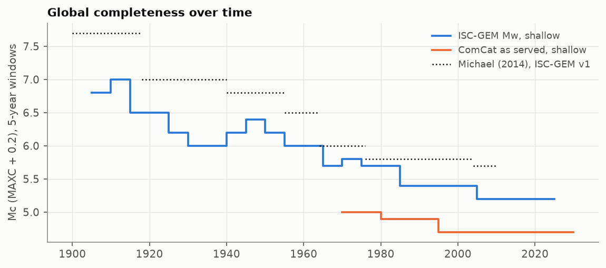

# Validation

All values are read from `results/validation.json`, `results/validation_table.json` and `results/sequences.json`
(run of 2026-11-13, fixed random seeds). Intervals are 95 %. A mismatch is reported as a mismatch.

Since v0.2 every atlas-method b uses the direct-Mw b sample (ISC-GEM Mw uncertainty 0.10; `method.md` §2.1). The
Michael (2014) rows in §2 keep every event, as he did. What changed against v0.1 is listed in §10.

## 1. Synthetic recovery (estimator)

60 synthetic cells per row. True b is drawn from 0.7–1.4 and true Mc from 5.0–6.0. Detection is a logistic
roll-off: 50 % at Mc − 0.2, about 88 % at Mc. In the two-period case, half the events come from a period that is
complete only above 5.7.

| Case | Events above Mc | Median bias of b | RMSE | 95 % CI coverage | Cells shown (A/B) | Max \|error\| when shown |
|---|---|---|---|---|---|---|
| one period | 30 | −0.052 | 0.249 | 1.000 | 0 % | – |
| one period | 50 | +0.035 | 0.182 | 1.000 | 2 % | 0.200 |
| one period | 100 | −0.018 | 0.140 | 0.983 | 40 % | 0.232 |
| one period | 200 | −0.021 | 0.105 | 0.933 | 72 % | 0.202 |
| one period | 500 | −0.020 | 0.059 | 0.983 | 95 % | 0.139 |
| one period | 1000 | −0.013 | 0.059 | 0.883 | 100 % | 0.186 |
| two periods | 100 | −0.002 | 0.150 | 0.950 | 47 % | 0.206 |
| two periods | 200 | −0.014 | 0.130 | 0.983 | 63 % | 0.284 |
| two periods | 500 | −0.011 | 0.082 | 0.933 | 92 % | 0.245 |
| two periods | 1000 | −0.008 | 0.051 | 0.950 | 100 % | 0.153 |

- **The estimator is nearly unbiased.** Median bias is within ±0.05 in every row, and within ±0.021 from 100
  events up.
- **Coverage is close to nominal**, 0.88–1.00. At n = 1000 (one period) it drops to 0.88: the residual roll-off
  just above Mc lowers b by about 0.01, which is now larger than the narrow interval.
- **The quality gate works as intended.** With ≤ 50 events almost nothing is shown, and the largest error among
  shown cells is 0.28.
- **Mc.** MAXC + 0.2 lands 0.1 above the true Mc in one-period cells and 0.2–0.3 above it in two-period cells.
  This is the conservative direction. Unit tests: `tests/` (18 pass).

## 2. Global b and Mc vs Michael (2014)

Michael (2014) analysed ISC-GEM v1 (2013, 1900–2009, magnitude selection thresholds 7.5 / 6.25 / 5.5). The ComCat
copy used here is a later release that adds about 12,000 pre-1960 events and extends to 2021 (Di Giacomo et al.
2018), so completeness is expected to differ.

| Test | Ours | Michael 2014 | Verdict |
|---|---|---|---|
| b, shallow < 60 km, 1918–2009, his Mc(t) | 1.078 [1.056, 1.102] (n = 8,768) | 1.05 | close; 0.006 outside our interval |
| b, ≥ 60 km, 1964–2009, Mc 5.7 | 0.997 [0.962, 1.033] (n = 2,811) | 0.99 | match |
| Mc, ≥ 60 km, 1964–2009 | MAXC 5.7, MBS 5.8 | 5.7 | match |
| Mc, < 60 km, 1964–1975 | MAXC 5.7, MBS 5.7 | 6.0 | lower by 0.3 |
| Mc, < 60 km, 1976–2003 | MAXC 5.4, MBS 5.7 | 5.8 | lower by 0.1–0.4 |
| Mc, < 60 km, 2004–2009 | MAXC 5.2, MBS 5.2 | 5.7 | lower by 0.5 |
| Mc, < 60 km, 1900–1963 (four periods) | 6.0–6.5 | 6.5–7.7 | lower by 0.5–1.2 |

- **Mc.** For the modern periods our Mc values are 0.1–0.5 lower than Michael's. They are consistent with Di
  Giacomo et al. (2015), who give completeness Mw 5.6 from 1964. Michael's values were chosen subjectively on a
  catalogue already cut at 5.5. The early periods differ most because the extension project added many smaller
  pre-1960 events. These are completeness estimates for today's catalogue, not errors in either study.
- **b.** For 1964–2003, b at Michael's own Mc values is 1.108 ± 0.030 (1964–1975) and 1.079 ± 0.015
  (1976–2003). Pooled over 1918–2009 we get 1.078, slightly above his 1.05; he reports 1.05 as fitting "within
  1 standard deviation". The difference is small but outside our interval. A likely cause is the catalogue
  version; we did not test it.
- **Atlas setting** (1976–2021, our floors, direct Mw): global b = 1.035 [1.018, 1.052] shallow (≤ 70 km) and
  0.936 [0.911, 0.961] deeper (v0.1, every event: 1.043 [1.025, 1.059] and 0.969 [0.945, 0.996]).

## 3. Regional b vs published values

Shallow ISC-GEM events, 1976–2021, region boxes as in `scripts/validate.py`, same estimator and floors as the map.
Published numbers come from local catalogues at much smaller magnitudes. A match only means the teleseismic
b-value agrees with the long-run local one; it does not prove the method.

| Region | Ours | Published | Verdict |
|---|---|---|---|
| California | 0.921 [0.741, 1.128], n = 74, B | ≈ 1.0 (Hutton, Woessner & Hauksson 2010, SCSN) | match (wide interval) |
| Chile | 0.852 [0.780, 0.931], n = 472, A | earlier: ≈ 1 (a 2018 national-catalogue study, weak source); now: Andean S. America b 0.855 ± 0.06 (GCMT, Kagan & Jackson 2013) | **weak reference replaced**: with the GCMT reference, ours matches (§3.1) |
| Japan | 0.942 [0.879, 1.012], n = 747, A | no verified number at Mw ≥ 5 found | reference only |
| Italy | n = 29 above Mc | ≈ 1.0 in Italian hazard models | **not testable**: too few Mw ≥ 5.4 events |
| Zagros vs Makran | Zagros 1.199 [0.957, 1.545] (C, n = 66); Makran n = 25 | Zagros highest, Makran lowest of the Iranian units (Iranian Plateau catalogue, J. Seismol. 2020) | same direction, but neither passes the quality gate |

### 3.1 Chile: why b is about 0.85 and not 1.0

All numbers in this section come from `scripts/val_chile.py` and `results/val_chile.json`. Every variant uses
ISC-GEM Mw at ≤ 70 km depth and, since v0.2, the direct-Mw b sample, except the two magnitude rows.

| Test | b [95 %] | n |
|---|---|---|
| Atlas setting (box 45–18° S, 76–66° W, 1976–2021, direct Mw) | 0.852 [0.780, 0.931] | 472 |
| Same, every event (v0.1 sample, v0.2 floors) | 0.920 [0.849, 0.992] | 584 |
| Only events with larger uncertainty (24 % of the box; 14 % globally) | 1.394 [1.185, 1.694] | 112 |
| Fixed thresholds 5.2 … 6.4 (Aki, no floor) | 0.824–0.892 | 910 … 89 |
| Box Mc: MAXC+0.2 / MBS / GFT, 1976–2003 | 5.7 / 5.4 / 5.3 | 371 |
| Box Mc: MAXC+0.2 / MBS / GFT, 2004–2021 | 5.4 / 5.0 / 5.0 | 828 |
| Without the 2010 Maule window (30 d before to 365 d after, 565 km) | 0.871 [0.783, 0.961] | 405 |
| Without the 2014 Iquique window | 0.872 [0.801, 0.962] | 443 |
| Without all five Mw ≥ 7.9 windows (1985, 1995, 2010, 2014, 2015) | 0.960 [0.866, 1.073] | 312 |
| Gardner-Knopoff mainshocks only | 0.675 [0.591, 0.783] | 180 |
| b-positive (time-ordered, above the period floor) | 0.882 [0.755, 1.008] | 190 differences |
| Interface only (PB2002 SUB within 200 km) / coastal strip 76–69° W | 0.848 / 0.851 | 444 / 461 |
| North 18–27° S / central 27–33° S / south-central 33–45° S | 0.817 / 0.848 / 0.880 | 124 / 168 / 180 |
| Depth ≤ 40 km / 40–70 km | 0.853 / 0.848 | 387 / 85 |
| 1976–2009 / 2010–2021 | 0.890 / 0.819 | 192 / 335 |
| Kagan & Jackson settings (1977–2010, m ≥ 5.8), Chile box | 0.871 [0.761, 1.015] | 182 |

- **Mc choice is not the cause.** Fixed thresholds from 5.2 to 6.4 give 0.82–0.89.
- **The large sequences pull b down only a little.** Removing any one of them changes b by less than 0.03.
  Removing all five raises it to 0.96, which includes 1.0. That is 34 % fewer events, and the interval widens.
  b-positive, which is less sensitive to short-term aftershock incompleteness, gives 0.882 and includes 1.0.
  Gardner-Knopoff declustering lowers b, as it does globally (§6).
- **Box, depth and period are not the cause.** All 29 box, depth, period, sequence-removal and fixed-threshold
  variants fall in 0.82–0.96.
- **Magnitude origin matters, in the opposite direction.** The proxy-Mw events (larger ISC-GEM uncertainty) have a
  much higher b. v0.1 included them (0.914); v0.2 leaves them out (0.852).
- **Stronger reference.** Kagan & Jackson (2013, Table 1) give β = 0.57 ± 0.04 (b = 0.855 ± 0.06) for the
  GCMT Flinn-Engdahl region "Andean S. America", 1977–2010, m ≥ 5.8. At the same settings, our Chile box gives
  0.871 [0.761, 1.015], and an approximate Andean envelope gives a TGR value of 0.903 [0.804, 1.014]. Both match.

**Conclusion: weak reference.** At Mw ≥ 5.4, Chile's teleseismic b on direct Mw is about 0.85–0.90, and the
published GCMT value (0.855) agrees. The earlier "≈ 1" came from a national catalogue at much smaller magnitudes.
No single choice moves the atlas value to 1.0. This fits the young-slab result in §4 (Nishikawa & Ide 2014).
Segment values from Crisosto & Tassara (2024), who use ISC b on 157 trench transects, could not be retrieved.

## 4. Plate-boundary type

Shallow ISC-GEM 1976–2021 events, nearest PB2002 step within 200 km:

| Class | b [95 %] | n |
|---|---|---|
| OSR oceanic spreading ridge | 1.480 [1.413, 1.565] | 1,358 |
| OTF oceanic transform | 1.174 [1.137, 1.217] | 2,698 |
| CTF continental transform | 1.035 [0.960, 1.117] | 761 |
| none (> 200 km from a step) | 0.977 [0.917, 1.023] | 1,287 |
| OCB oceanic convergent | 0.976 [0.896, 1.061] | 535 |
| SUB subduction | 0.971 [0.948, 0.994] | 6,287 |
| CRB continental rift | 0.965 [0.905, 1.039] | 687 |
| CCB continental convergent | 0.930 [0.872, 0.993] | 703 |

Direct-Mw sample (v0.2). On every event (same floors) the values are 0.996–1.491; the largest shifts are SUB
1.001 → 0.971, CRB 1.011 → 0.965 and CCB 0.971 → 0.930 (`plate_boundary_types_all_events`).

| Comparison | Published | Verdict |
|---|---|---|
| SUB | b = 1.5 × 0.654 = 0.98 (GCMT subduction zones 1977–2010, as quoted from Kagan & Jackson) | match |
| OSR | β 0.8–1.1 → b 1.2–1.65 for mid-ocean events (Kagan 2002, quoted in Kagan 2010) | match |
| non-ridge classes | universal β 0.63–0.67 → b 0.95–1.0 (Kagan 1999; Bird & Kagan 2004) | SUB, CRB, OCB, CTF, CCB match within their intervals; the CCB point value (0.930) is below the range |
| Ranking | spreading highest; thrust and convergent lowest (Schorlemmer et al. 2005; TRACE 2026, see below) | match |
| Subduction, young slabs (Mexico–Central America, Nankai–Ryukyu, south-central Chile, Cascadia) vs old (Japan Trench, Kuril–Kamchatka, Izu–Bonin–Mariana, Tonga–Kermadec) | b increases with slab age (Nishikawa & Ide 2014) | **match**: young 0.899 [0.832, 0.973], old 1.067 [1.018, 1.112]; the intervals do not overlap |

The slab-age groups use approximate literature ages assigned by region. The PB2002 `SEAFLOORAG` field holds codes
(220, 260), not ages, for subduction steps, so it could not be used.

Kagan (2010) warns that high oceanic b/β values partly reflect mixing populations with different corner
magnitudes. The OSR value is a real property of the catalogue, but it is not necessarily a different physical
power-law exponent.

**TRACE (arXiv 2603.21152).** The brief for this project quoted TRACE as reporting Mc ≈ 5.3–5.4 and b 0.6–1.8 by
plate-boundary type (GCMT Mw ≥ 5). We read the full HTML text of v4 (30 Sep 2026) and found only local b-values
(Ridgecrest, Sanriku). A search-engine summary of the PDF mentions a GCMT 1980–2023 Mw ≥ 5 analysis with median
b of about 1.12 for spreading centres and 0.93 for extension, with subduction, collision and transforms lower. We
could not confirm this in the text. It is treated as an unverified comparison: it agrees with our ranking, and its
spreading-centre value is lower than our OSR 1.48.

## 5. ComCat vs ISC-GEM b (catalogue consistency)

Global shallow events, 2004–2021, same years in both catalogues:

| Cutoff | ISC-GEM | ComCat as served | ComCat Mw proxy |
|---|---|---|---|
| 5.0 | 1.046 | 1.134 | 1.404 |
| 5.2 | 1.085 | 1.081 | 1.347 |
| 5.4 | 1.038 | 1.049 | 1.111 |
| 5.6 | 1.059 | 1.055 | 1.077 |
| 6.0 | 1.077 | 1.054 | 1.055 |

- The mb → Mw proxy inflates b by 0.25–0.36 below Mw 5.4. This is why the atlas never computes b on converted
  magnitudes.
- From 5.6 up, all three agree within about 0.03.

## 6. Robustness

| Check | Result |
|---|---|
| Radius 200 / 400 km vs 300 km | median \|Δb\| 0.042 / 0.039 on common cells (v0.1: 0.035 / 0.039) |
| b-positive vs b (shown cells) | median +0.046; b⁺ inside the b interval in 64.9 % of cells (v0.1: +0.029, 87.8 %; iid null about 96 %); explained in `bpositive.md` |
| Gardner-Knopoff declustering | global shallow b 1.035 → 0.887; per-cell median −0.202 (not used for the map, see method §6) |
| Cutoff-stability flag | 4.7 % of shown shallow cells |

## 7. Omori-Utsu

- **Synthetic check.** 20 sequences with true p 1.05, c 0.05 days, Mm 8 and Mcat 4.5, with early events lost
  below Mc(t). Recovered: mean p 1.063, between-run SD 0.025, mean σp 0.028, median c 0.056.
- **Real sequences.** 40 sequences: 17 A, 10 B, 8 C, 5 insufficient. p of the A sequences ranges 0.80
  (2003 Tokachi-Oki) to 1.25 (1996 Biak). The 2011 Tohoku sequence gives p = 1.003 ± 0.011, but c is not
  resolved.
- **Not compared with published values.** No published p/c/K for these sequences was verified in this phase,
  because published fits use different catalogues, magnitude thresholds and windows. The estimator itself was
  validated against USGS operational aftershock forecasts in an earlier study by the same author on Ridgecrest
  (p 1.087 vs 1.10). That used a local catalogue and is not repeated here.

## 8. Published b, β and Mc at teleseismic magnitudes

The full table with exact quotes and table numbers is in [`literature-values.md`](literature-values.md). The data
is in `scripts/val_literature.json`, and the code is `scripts/val_literature.py`. All 16 entries are flagged
`needs_human_check`, because they were extracted with LLM assistance.

- **Ten regional values match** (in v0.1 and v0.2), nine of them on approximate boxes. They come from Kagan & Jackson 2013,
  Table 1: GCMT 1977–2010, m ≥ 5.8, tapered G-R β. Only the Tohoku box (35–40° N, 140–146° E) is defined
  exactly. Ours there is 1.023 [0.799, 1.260] (n = 93; v0.1 1.082, n = 105), against 0.96 ± 0.11 (published
  n = 109).
- **Global and subduction aggregates now match (v0.2).** On the direct-Mw sample: global 1982–2008, m ≥ 5.6,
  TGR 1.035 [1.012, 1.062] against Kagan (2010) 1.016 (z = 1.53); trenches 0.992 [0.955, 1.029] against 0.969;
  all 18 subduction zones 0.977 [0.938, 1.013] against 0.975. In v0.1 (every event) all three mismatched, higher
  by 0.06–0.08 (global 1.087 [1.063, 1.110], z = 5.93).
  - The proxy-Mw events are 14.6 % of Mw 5.6–6.0 and about 1 % from Mw 7.0 up. Alone, they give
    b = 1.736 [1.633, 1.850].
  - The marker (uncertainty 0.10 = direct Mw) is checked against GCMT magnitudes in ComCat (99.97 % agreement,
    `method.md` §2.1), not against ISC-GEM's own source column, which the ComCat copy does not carry.
- **Declustered global b mismatches**, and more so in v0.2 (0.903 against 0.972, z = −5.13; v0.1 0.934,
  z = −2.50). Gardner-Knopoff is not Kagan's declustering.
- **Mc matches.** The global MAXC+0.2 for 1980–2016 at 0–50 km is 5.4, against GCMT Mc 5.4–5.5 (Petruccelli 2018).
- **The β range over classes mismatches at the top end.** Our OSR β is 0.98 (v0.1: 1.02), against a published maximum of 0.92
  (Bird & Kagan 2004, abstract). The per-class table was not read.

## 9. Retrospective b before and after the 40 sequences

`scripts/val_bt.py` adds a `bt` field to `site/data/sequences.json` (schema in `data-schema.md`). It gives b in
four windows:
- 5 years before the mainshock;
- 1 year before;
- 0–30 days after;
- 30–365 days after.

The data is ISC-GEM Mw inside the sequence circle. The threshold is the atlas floor, raised to the window MAXC+0.2
and, after the mainshock, to Mc(t) = Mm − 4.5 − 0.75 log₁₀ t. **This describes the catalogue in hindsight. It is
not a forecast.**

- **Most windows are too small.** Of 40 sequences, 4 are outside ISC-GEM's coverage (1976–2021). The number of
  sequences with b shown (quality A/B) is:
  - 2 for 5 years before (v0.1: 3);
  - 0 for 1 year before;
  - 1 for 0–30 days after (v0.1: 2);
  - 1 for 30–365 days after (v0.1: 2).

  At Mw ≥ 5.2–5.7, only the largest sequences have enough events. Teleseismic Mw catalogues cannot resolve b(t)
  for most M 8 sequences.
- **Shown values:**

| Sequence | 5 yr before | 0–30 d after | 30–365 d after |
|---|---|---|---|
| 2004 Sumatra–Andaman | insufficient | insufficient (n = 49) | C |
| 2011 Tohoku | 0.873 [0.721, 1.068] B | 0.948 [0.795, 1.135] B | 0.888 [0.768, 1.047] A |
| 2021 Kermadec | 0.904 [0.751, 1.140] B | insufficient | not covered |
| 2013 Santa Cruz Is. | C | insufficient | insufficient |

  Direct-Mw sample (v0.2). In v0.1 Sumatra (0–30 d, 30–365 d), Maule (0–30 d) and Santa Cruz (5 yr before) were
  also shown; with the proxies removed they fall below 50 events or get wider intervals.

- **Tohoku is the only sequence with b shown both before and after.** The change is +0.015, and the intervals
  overlap: no detectable change at this magnitude range.
- **Published comparison.** No published before/after b at Mw ≥ 5 for a single great earthquake was found.
  - The closest is Srivastava et al. (2021, arXiv:2108.06557, preprint; ISC mb, 92–100° E). For Sumatra they
    report b 1.04 in the five years before 2004 and 1.14 after.
  - Our replication in the same band (13° S–11° N) has only 12 events above threshold in 2000–2004, against 280
    in 2005–2009 (b 1.026 [0.871, 1.175]). It is **not testable**, so we cannot confirm or contradict the
    direction.
  - Nanjo et al. (2012) and Nuannin et al. (2005) describe a pre-2004 decrease, but their catalogues and
    magnitudes could not be verified from the text we read.
  - A 2026 preprint (arXiv:2603.22745) reports no rolling-b change before M ≥ 6 in Chile and Japan in ComCat.
- **Assumption.** The Mc(t) coefficients (4.5, 0.75) were derived for California. They are applied here unchanged.

## 10. v0.2: direct-Mw b sample, before and after

v0.1 used every ISC-GEM event of 1976–2021; v0.2 uses only direct Mw (uncertainty 0.10; `method.md` §2.1). Both runs
use the same data cut-off and seeds. The v0.1 numbers were recomputed with `ATLAS_B_MAGERR_MAX=all` and reproduce
the committed v0.1 outputs exactly (every number in `results/*.json` and every cell file unchanged).

| | v0.1, every event | v0.2, direct Mw |
|---|---|---|
| Events in the b sample, 1976–2021 | 56,585 | 49,536 (7,049 proxy Mw left out) |
| Global b, shallow ≤ 70 km | 1.043 [1.025, 1.059], n = 15,827 | 1.035 [1.018, 1.052], n = 15,725 |
| Global b, deeper | 0.969 [0.945, 0.996], n = 5,419 | 0.936 [0.911, 0.961], n = 4,976 |
| Floors, shallow, 1976–2003 / 2004–2021 | 5.7 / 5.2 | 5.8 / 5.3 |
| Floors, deeper, 1976–2003 / 2004–2021 | 5.4 / 5.4 | 5.4 / 5.2 |
| Shallow cells A / B (shown) | 80 / 124 (204) | 58 / 112 (170) |
| Deeper cells A / B (shown) | 22 / 48 (70) | 24 / 49 (73) |
| Per-cell change, shallow (167 cells shown in both) | – | median −0.019 (IQR −0.047 to +0.015); 63 % lower |
| Per-cell change, deeper (66 cells shown in both) | – | median −0.036 (IQR −0.054 to −0.015); 86 % lower |
| b-positive inside the b interval (shown shallow cells) | 87.8 % | 64.9 % |

- Shallow cells shown only in v0.1: 37; only in v0.2: 3. Deeper: 4 and 7.
- With every event but the v0.2 floors, global shallow b is 1.053; so the floor change alone moves it by +0.010
  and leaving the proxies out by −0.018.
- **b-positive did not follow.** In the 77 shallow cells with b and b-positive in both runs, b fell by a median
  0.022 and b-positive rose by 0.002. §11 and `bpositive.md` explain why.

**Verdicts that changed** (site validation table, `results/validation_table.json`):

- Literature: Kagan & Jackson (2013) all 18 subduction zones, Kagan (2010) global and Kagan (2010) trenches go
  from **mismatch to match**.
- Chile spread: the variant range moves from 0.86–0.98 to 0.82–0.96 (verdict text only; still "robust").
- No verdict went from match to mismatch. The declustered Kagan (2010) value stays a mismatch and moves further
  (z −2.50 → −5.13). The boundary-class ranking changes order below OTF/CTF (SUB now below "none" and OCB) but
  keeps its verdict. The Sumatra b(t) row stays "not testable". Michael (2014) rows are unchanged by design.

**The 16 literature comparisons** (primary estimator: TGR for every β entry):

| # | Entry | Published b | v0.1 (all events) | v0.2 (direct Mw) | Verdict v0.1 → v0.2 |
|---|---|---|---|---|---|
| 1 | `kj2013_fe01_alaska_aleutian` | 0.975 | TGR 0.990 [0.865, 1.133] (z +0.16) | TGR 0.915 [0.808, 1.044] (z -0.70) | match (approximate region) |
| 2 | `kj2013_fe05_mexico_guatemala` | 0.900 | TGR 0.819 [0.660, 1.021] (z -0.63) | TGR 0.795 [0.639, 0.946] (z -0.88) | match (approximate region) |
| 3 | `kj2013_fe06_central_america` | 1.020 | TGR 1.038 [0.880, 1.283] (z +0.13) | TGR 1.025 [0.868, 1.244] (z +0.04) | match (approximate region) |
| 4 | `kj2013_fe08_andean_south_america` | 0.855 | TGR 0.970 [0.866, 1.073] (z +1.43) | TGR 0.903 [0.804, 1.014] (z +0.60) | match (approximate region) |
| 5 | `kj2013_fe12_kermadec_tonga_samoa` | 1.200 | TGR 1.259 [1.156, 1.389] (z +0.70) | TGR 1.212 [1.108, 1.314] (z +0.15) | match (approximate region) |
| 6 | `kj2013_fe18_guam_japan` | 1.290 | TGR 1.285 [0.993, 1.651] (z -0.02) | TGR 1.259 [0.998, 1.631] (z -0.14) | match (approximate region) |
| 7 | `kj2013_fe19_japan_kamchatka` | 0.930 | TGR 1.072 [0.969, 1.201] (z +1.69) | TGR 0.993 [0.898, 1.116] (z +0.77) | match (approximate region) |
| 8 | `kj2013_tohoku_box` | 0.960 | TGR 1.082 [0.860, 1.333] (z +0.76) | TGR 1.023 [0.799, 1.260] (z +0.40) | match |
| 9 | `kj2013_fe24_sunda_arc` | 0.975 | TGR 1.077 [0.901, 1.253] (z +0.95) | TGR 1.018 [0.862, 1.211] (z +0.40) | match (approximate region) |
| 10 | `kj2013_fe46_andaman_sumatra` | 1.065 | TGR 1.010 [0.868, 1.151] (z -0.43) | TGR 0.921 [0.798, 1.080] (z -1.13) | match (approximate region) |
| 11 | `kj2013_all_18_subduction_zones` | 0.975 | TGR 1.034 [0.996, 1.073] (z +2.37) | TGR 0.977 [0.938, 1.013] (z +0.08) | **mismatch → match** (approximate region) |
| 12 | `kagan2010_global_mt56` | 1.016 | TGR 1.087 [1.063, 1.110] (z +5.93) | TGR 1.035 [1.012, 1.062] (z +1.53) | **mismatch → match** |
| 13 | `kagan2010_trenches_mt56` | 0.969 | TGR 1.053 [1.013, 1.094] (z +4.07) | TGR 0.992 [0.955, 1.029] (z +1.20) | **mismatch → match** (approximate region) |
| 14 | `kagan2010_global_declustered_mt56` | 0.972 | TGR 0.934 [0.902, 0.962] (z -2.50) | TGR 0.903 [0.874, 0.926] (z -5.13) | mismatch (approximate region) |
| 15 | `birdkagan2004_pb2002_class_range` | β 0.53–0.92 | β 0.65–1.02 | β 0.63–0.98 | mismatch (approximate) |
| 16 | `petruccelli2018_gcmt_mc_map` | Mc 5.4–5.5 | MAXC+0.2 5.4, MBS 5.6 | MAXC+0.2 5.4, MBS 5.8 | match |

## 11. b-positive vs b on the direct-Mw sample

`scripts/val_bpos.py` → `results/val_bpos.json`; full write-up in `bpositive.md`. The cells are the shown shallow
cells with b-positive; the medians carry 95 % bootstrap intervals over cells.

| Test | Result | Verdict |
|---|---|---|
| (a) Floor too low for the direct sample | Raising each cell's threshold by +0.2/+0.4 lifts b by +0.022/+0.054 (direct) and +0.032/+0.062 (every event); the direct − every gap stays −0.024 to −0.028 up to +0.3. Mc-Lilliefors: 5.8 for 1976–2003 (= floor); 6.1 for 2004–2021, the same for every event (pooled-shape rejection). 61/76 cells pass at the atlas threshold. | rejected |
| (b) Time-correlated thinning | Proxies are 51.8 % of above-floor events in the first day after a larger event, 4.4 % later. Paired, same floors: b −0.024, shuffled b⁺ −0.026, b⁺ −0.011; time-order part +0.013 [−0.000, +0.028]. Synthetic STAI lowers b and shuffled b⁺, not b⁺. Blind windows (0.25–2 d) do not close the gap. | cause of the v0.2 change |
| (c) b⁺ bias (small n, 0.01 vs 0.1 magnitudes) | iid G-R null with the cells' sizes and floors: b⁺ − b +0.005 / +0.008, inside 96.8 % / 96.4 % | rejected |
| (d) Boundary class | The time-order part appears in SUB and other cells alike. The order-free part is +0.012 (SUB) vs +0.073 (other) in v0.1; a tapered G-R with corner 7.0 / 7.5 gives +0.061 / +0.020 | order-free part depends on class |

No change to floors or estimators; the global b, A/B cells and validation verdicts are unchanged.

## Not verified

- The ISC-GEM version of the ComCat copy (not stated by ComCat), and whether results change with v13.0.
- The USGS public-domain statement: usgs.gov pages returned bot-protection pages and timeouts on 2026-11-13.
- Exact coefficients of Scordilis (2006). Only the slopes were confirmed through a secondary source; the
  intercepts are our own.
- Bird & Kagan (2004) per-class β values. Their tables were not retrievable, so the class comparison uses Kagan's
  universal β and the ridge range instead.
- TRACE's global plate-boundary b numbers (see §4).
- Every literature entry in §8 (`needs_human_check: true`); Flinn-Engdahl regions approximated by boxes.
- That ISC-GEM magnitude uncertainty 0.10 marks direct Mw. It is checked against GCMT magnitudes in ComCat
  (99.97 % of GCMT-sourced matches carry 0.10), not against ISC-GEM's own direct/proxy column, which the ComCat
  copy lacks (`method.md` §2.1).
- The tapered-distribution reading of the order-free part of b-positive − b (§11): no corner magnitude was fitted
  per cell. The full text of van der Elst (2021) was not accessible.
- The ISC-GEM overview and Di Giacomo et al. (2018) quotes in `method.md` §2.1 (read through a summariser).
- Mc(t) coefficients at teleseismic scale (§9).
